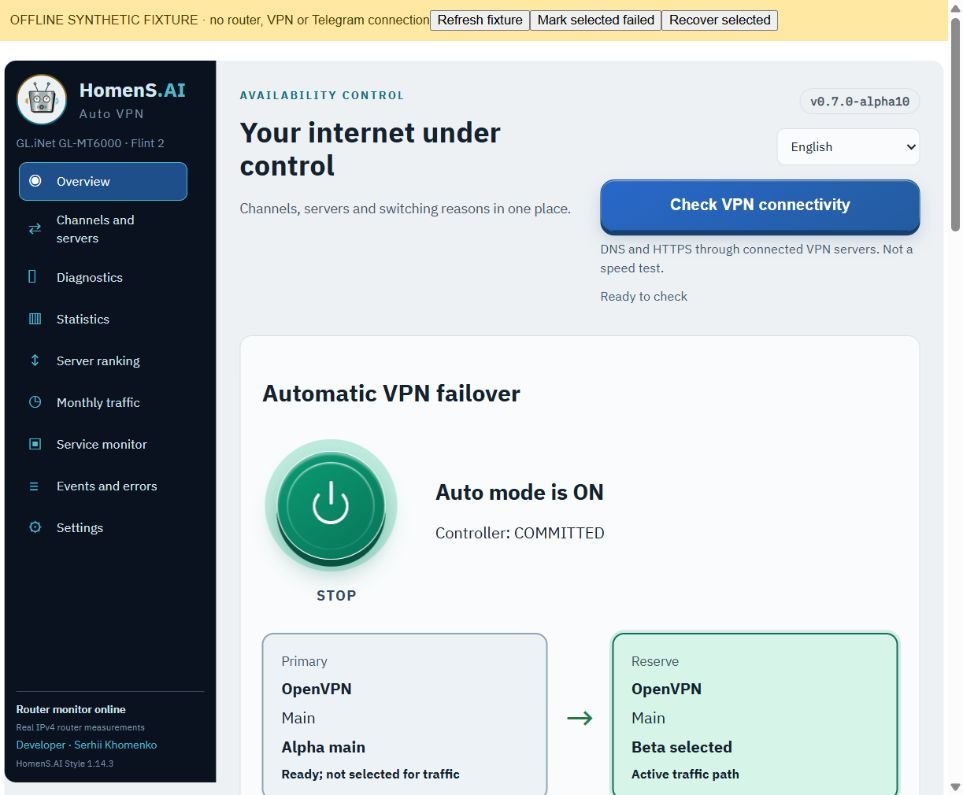

# HomenSAI Auto VPN · GL-MT6000

> ## ⚠ Experimental software: use at your own risk
>
> HomenS.AI Auto VPN is an **experimental alpha release** for the GL.iNet GL-MT6000. It can interrupt your internet connection and it changes router VPN settings. It is provided **"AS IS", without warranty of any kind** (MIT License). **You install and use it entirely at your own risk and responsibility.** Make a backup first and keep another way to reach the internet and the router. Read the full [terms of use](DISCLAIMER.md). The program shows the same terms the first time you open it and does not allow Auto until you accept them.

Latest prerelease: **0.8.0-alpha11-1** ([release notes](releases/v0.8.0-alpha11.md) · [install guide](docs/INSTALL.en.md) · [router test kit](router-test-kit/README.md) · [terms of use](DISCLAIMER.md)).

[English](README.md) · [Русский](README.ru.md) · [Developer: Serhii Khomenko / HomenS.AI](https://homensai.com)

[Exact verified router/firmware/LuCI versions and installation proof](docs/TESTED-ENVIRONMENT.en.md)

**Alpha10:** viewport-aware sidebar, accessible Settings, independent menu scroll and mobile wrapping; 126 EN/RU page transitions checked.

**Previous alpha9:** only the selected healthy overview path is green; a healthy standby is grey/ready, transitions yellow and real failures red. [Colour contract](docs/OVERVIEW-PATH-COLOURS.md).

**Previous alpha8:** brighter raised controls and 18px server indicators, request-correlated VPN connectivity checks, explicit controller states, failure diagnosis and model quarantine. Verified locally with 329 application tests, 30 QA tests per runtime and 12 UI suites; [item-by-item limits](docs/ALPHA8-UX-ALGORITHMS-RESULTS.md). The physical router has not been upgraded to alpha8; full native multi-hop production acceptance is pending.

Previous verified checkpoint:

**0.7.0-alpha6 local prerelease: complete offline cascade model and rollback/fault protection, 232 application + 5 QA tests, 8 Node suites and 54 responsive EN/RU checks. See [offline completion](docs/OFFLINE-COMPLETION.md). QEMU was not resumed and the physical router was not changed. Native multi-hop adaptation and unattended production remain unaccepted.**

[Virtual OpenWrt results and unresolved reboot failure](qa/OPENWRT-VIRTUAL-REPORT.md) · [Reproducible Docker/QEMU lab](lab/openwrt-qemu/README.md)

## Why it exists

The idea came from a real troubleshooting session: VPN profiles showed Connected while internet access stopped. The standard interface and noisy logs did not clearly show which server/path was healthy or how connections changed. We needed coordinated switching between servers and between OpenVPN and WireGuard. Trustworthy monitoring comes first; bounded client-confirmed switching is experimental; full unattended hierarchy remains a development stage. Wi-Fi is an access medium and a firewall controls traffic; they are not VPN protocols.

| Mode | Implementation status |
|---|---|
| Monitor | Working native service: existing profiles, IPv4 HTTPS/DNS probes, latency, traffic, events and Telegram. |
| Operation / automatic failover | Bounded client-confirmed experiment verified for two already connected profiles. Generic production `native_apply=false` remains intentional; inactive-profile startup and a full server/channel/protocol hierarchy are unfinished. See [current state](docs/STATE.md). |

## Interface and statistics

English by default, explicit English/Russian selector. Server cards, real HTTPS-latency chart, grouped OpenVPN/WireGuard histograms for today, last seven calendar days and current calendar month. Green: healthy observed time; red: confirmed failed time; grey: unobserved time. Inactive reserve profiles are excluded. Counts mean observed inactive-to-active transitions and distinct failure episodes, not probe counts. Startup is not a new connection. Durations are estimates between probes. New history starts with this release.

Calendar-month accounting sums unique VPN interfaces, including overhead, starting when monitoring begins. WAN is tracked separately where an explicit WAN device is identifiable; WAN and VPN counters overlap and must not be added. Neither reconstructs an unobserved previous month. Simultaneous connected tunnels do not prove which one carried a LAN client's traffic. Checkpoints default to 15 minutes; power loss can lose the latest interval. Monitor events are mostly RAM-only; bounded native-controller history has a checksummed persistent backup.

Telegram is optional: setup wizard, private token, approved chat/channel destination, interval or daily Europe/Berlin hour, weekly/monthly summaries and a persistent deduplication ledger. The token is required even for sending. Router backups may contain it: keep them private.

## Installation and test evidence

[How it works (EN)](docs/HOW-IT-WORKS.en.md) · [Как это работает (RU)](docs/HOW-IT-WORKS.ru.md) · [Install (EN)](docs/INSTALL.en.md) · [Установка (RU)](docs/INSTALL.ru.md) · [AI installation prompt](docs/AI-INSTALL.en.md) · [Промпт для AI](docs/AI-INSTALL.ru.md) · [Validation](docs/VALIDATION.md) · [Changelog](CHANGELOG.md)

Download matching `.ipk` and `.ipk.sha256` from release assets or `releases/`. This is NOT a firmware image. Target: **GL.iNet GL-MT6000, GL.iNet 4.11.0, OpenWrt 21.02-SNAPSHOT, LuCI openwrt-21.02 git-22.335.71649-0ecaf74, vendor Python 3.9.15**. Development/tests use Linux Docker on Windows. `Architecture: all` means interpreted files, not universal router compatibility. Generic OpenWrt 21.02.7 x86/64 was tested separately in an isolated QEMU guest (kernel 5.4.238 / Python 3.9.16). Its proprietary GL.iNet adapter is intentionally blocked; this does not establish other-hardware failover compatibility.

Earlier releases verified installation, three connected OpenVPN/WireGuard probe paths, accounting and Telegram delivery. On 15 Oct 2026, alpha10 verified a real client-confirmed transition/return and a separate automatic transition under controlled primary traffic failure, followed by independent rollback. Helper completion errors and later checks are documented without being counted as successful helper exits. See [work log](docs/WORKLOG.md) and [validation](docs/VALIDATION.md). Simulation reports under `qa/` are separate evidence.

## Privacy

Public files exclude the author's live router/VPN configuration, Telegram token/chat ID, private keys, passwords, browser sessions, logs, firmware dumps and live-device screenshots. Isolated VM screenshots contain only synthetic test profiles. Runtime secrets belong only on the router. Router probes do not validate LAN routing; IPv6, inactive-server bandwidth tests and automatic operation are unavailable.

## Author, book and related work

**Serhii Khomenko | HomenS.AI** combines mechanical engineering, project leadership, IT infrastructure and local AI. Public profile: practical tools, automation, Docker and local models. [Website/profile](https://homensai.com/profile.html) · [GitHub](https://github.com/HomenSAI) · [ORCID](https://orcid.org/0009-0009-5371-9717).

Book: **Two Worlds. One Mind.**, edition 1.1, a handbook connecting mechanical engineering, software and AI. [Book repository](https://github.com/HomenSAI/two-worlds-one-mind) · [Zenodo / DOI 10.5281/zenodo.23160031](https://zenodo.org/records/23160031). Other public work: [local AI lab](https://github.com/HomenSAI/homensai-local-ai-lab), [RTX 3080 benchmarks](https://github.com/HomenSAI/rtx3080-local-ai-benchmarks).

Independent project, not an official GL.iNet/OpenWrt product. Licensed under [MIT](LICENSE): use, modify and redistribute, including commercially, while retaining the author/site notice and licence. See [licensing scope and third-party notices](LICENSING.md).

Physical device: last recorded installed application is 0.6.0-alpha5; this window did not query it. Current alpha5 here means 0.7.0-alpha5 in the isolated x86 VM, not a physical upgrade. See [current state](docs/STATE.md) and [alpha5 evidence](qa/ALPHA5-CHECKPOINT.md).

[Failover planner and rollback contract / Планировщик и откат](docs/FAILOVER-RESEARCH.md): read-only planner integrated; full native hierarchy application remains unfinished; bounded pair operation is documented separately.

[Native controller, actual device results and restrictions](docs/NATIVE-EXPERIMENTAL.md) · [Work log](docs/WORKLOG.md)

[Working-system TODO / План доведения](docs/TODO-WORKING-SYSTEM.md) · [Client trial / Клиентское испытание](docs/CLIENT-TRIAL.md). Candidate 0.7.0-alpha5 adds committed-reserve observation and verified primary return; hardware acceptance of this candidate remains pending.

Independent Claude review checkpoint: [start here](.claude/handoff/START-HERE.md), [all 50 audit items](.claude/handoff/TODO-50.md), [readiness gates](.claude/handoff/ROUTER-READINESS.md). Root CLAUDE.md imports the project handoff. Tests are stopped; this is an audit-first handoff, not device deployment authorization.

Version identities: application **0.8.0-alpha2**, package **0.8.0-alpha2-1**, Claude review bundle **1.0.0** ([VERSION.json](VERSION.json), [policy](docs/VERSIONING.md), [handoff release notes](releases/handoff-v1.0.0.md)). Handoff releases contain review context and do not imply a new router package.

Download the [Claude review handoff 1.0.0 release](https://github.com/HomenSAI/homensai-gl-mt6000-auto-vpn/releases/tag/handoff-v1.0.0): sanitized context ZIP, VERSION.json and SHA256SUMS.txt. This archive is not a router installation package.
