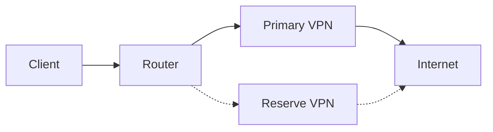

# Current state and guide — 24 October 2026

Development: **0.9.1-alpha11**, branch `feature/owner-ui-20261023`, a candidate with refreshed training and documentation. The public stable release remains **0.9.0**. The last verified dedicated MT3000 installation is **alpha9**. Alpha10 passed a separate virtual audit; its results do not establish physical installation or acceptance of alpha11.

## First entry and training

Current-version terms appear until first acceptance on that router, followed by the introduction, training and setup. Training can be reopened. All eight lessons have a vector interactive diagram with Play/Pause, Previous step, Next step and Reset. Playback stops at the final frame, on lesson navigation or when hidden. A text sequence accompanies every illustration. These are teaching examples: they perform no RPC and control no VPN. A quiz score is not Auto readiness certification.

## The VPN pair and eight setup steps

1. System: inspect the existing configuration.
2. Monitoring: probe and persistence intervals.
3. Existing VPNs: select two distinct configured clients and assign primary/reserve roles. Protocols and profiles are already bound in stock GL.iNet VPN. Two profiles belonging to one client are not independent channels. A configured stopped client may be listed; that does not prove health.
4. Names/priorities: application metadata, not VPN keys. The old `default` metadata group is not a channel role.
5. Recovery: thresholds, dwell/cooldown and return policy.
6. Speed: optional tests consume traffic.
7. Telegram: optional, keep tokens private.
8. Review/save. Next only navigates; saving neither accepts terms nor starts Auto. The dashboard escape preserves existing settings and does not save a draft.

Configure servers, credentials and keys in stock VPN; refresh Auto VPN afterwards and wait for fresh checks. Saving the pair changes application metadata. Explicit Start may start prepared clients and select their traffic policies. Both tunnels can be connected while only one common traffic route is selected.

## Overview and controls

Automatic VPN switching comes first. Monitoring is at its upper right; Check VPN now is alongside the controls. Below are collapsed technical actions and switching statistics, then manual channel selection. Primary is always first/left, reserve second/right. Manual-selection explanations sit below the pictures. A queued request is not proof of completion.

Manual selection may operate with Auto on when readiness allows it. Auto continues observation and recovery on confirmed failure, respecting operator preference and return policy. Using reserve does not justify returning to a failed primary. Auto requires explicit Start after an application/router restart.

## Channels, latency and lists

Configured server names and protocols are explicit. Current peer IP:port requires fresh identity-bound observation. Missing historical names/IPs are not reconstructed from today's connection. Roles marked current pair describe today's settings.

Delay is HTTPS RTT, not ICMP ping. The lower-delay recommendation requires fresh comparable successful checks and never switches traffic itself. The graph and weighted mean/min/max/success-count table follow the1–24h window. Min/max describe observed minute means; gaps are not filled.

Your VPNs shows the selected pair, with other profiles collapsed. Current server checks shows five rows and speed ranking five entries before expansion. Search/sort operate across the full data. An inactive profile is not automatically a failure of an in-use channel.

## Failure chart and journals

Collapsed Overview statistics contains route switching and hourly failure-episode counts sharing the1–24h window. Primary/reserve/unrecorded roles are separate. FAILURE until recovery is one episode despite repeated failed checks. Bar tooltips describe the selected route during that hour; incomplete coverage is explicit.

The live terminal pins monitor/Auto/primary/reserve status above its log. Its one-second clock does not increase network probe cadence. New rows appear first; consecutive equal states form a timestamp range. A→B→A remains distinct. Operator/program/test/controller provenance is shown when recorded, separating requests from confirmed effects.

Events and errors shows10rows before expansion, search and time/state sorting. Detailed history lasts7days within the storage budget; monthly/lifetime counters persist. Outages, failed checks, attempts and confirmed switches differ. Preparation without a pair is separate; missing completion has an explicit reason. Transition delay is an immutable event-time measurement, not current RTT. Technical exports retain original identifiers.

## LAN helper and readiness

Prepared-MT3000 router-probed IPv4 Auto does not require the optional LAN helper. A client-confirmed trial does require its independent helper. Router checks do not establish client DNS/HTTPS/exit/IPv6/Kill Switch acceptance. Use readiness for the selected mode. Help includes manual instructions, short topic prompts and a general diagnostic prompt. An agent needs actual tools and protected access; a plain chat cannot install software by itself.

## Installation and evidence

For public stable installation use [the guide](INSTALL.en.md), pinned v0.9.0 tag and matching IPK/checksum/verification/install kit. Do not downgrade a newer installation. For a candidate use `releases/`, VERSION.json and checksum from the same exact branch commit; the stable kit is not the candidate kit. Verify model/firmware, private backup and readiness; do not bypass refusals or flash firmware to install this app.

[Alpha10 VM audit](handoff/VM-AUDIT-2026-10-24.md): two in-OpenWrt builds matched the package; install/update/rollback/restart/reboot passed;86files/modes matched.76prompts were inventoried with explicit command-recipe coverage. This is not named external-model execution or exhaustive fault combinations. Real GL/LAN, native browser visual acceptance and several fault scenarios remain untested. [Matrix](../qa/OWNER-PROMPT-VM-ALPHA10-2026-10-24.json).

Dated reports and old release notes retain their historical evidence. The [index](DOCUMENTATION-INDEX.md) distinguishes current instructions from history. Never publish keys, passwords, VPN files or unredacted backups in chat/Git.

## Route diagram

Dashed links represent standby in this example. Actual selection requires router evidence, not the illustration.
