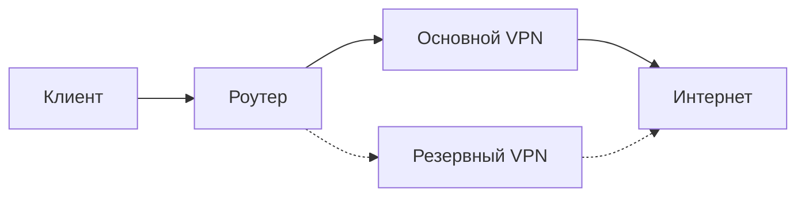

# Текущее состояние и руководство — 24 октября 2026

Текущая версия: **0.9.1-alpha13**, ветка `feature/owner-ui-20261023`. На выделенном MT3000/4.11.0 установлена alpha13: Auto включён, подтверждён резерв, оба VPN прошли DNS/HTTPS. Проверены87файлов приложения, HTTP/HTTPS и шифрованные копии до/после. Stable **0.9.0** не изменён. Alpha12 ранее осталась с выключенным Auto после guarded-start отказов; alpha11/alpha9 — предыдущие физические базы, alpha10 — отдельный старый VM-аудит. [Матрица alpha13](../qa/OWNER-BATCH-ALPHA13-2026-10-24.json).

## Первый вход и обучение

Условия показываются до первого принятия текущей версии на конкретном роутере. Далее — объяснение работы и мастер настройки. Обучение доступно отдельно, к нему можно вернуться позже. В каждом из восьми уроков есть векторная интерактивная схема: «Запустить/Пауза», «Шаг назад», «Шаг вперёд», «Сначала». Проигрывание останавливается на последнем шаге, при уходе с урока или скрытии схемы. Порядок шагов также доступен текстом. Схемы — учебные примеры, они не выполняют RPC и не управляют реальными VPN. Результат теста знаний не подтверждает готовность Auto.

## Пара VPN и мастер из восьми шагов

1. Система: ознакомьтесь с текущей конфигурацией.
2. Мониторинг: интервалы и запись измерений.
3. Существующие VPN: выберите два разных настроенных клиента и назначьте роли основного/резерва. Протоколы и профили уже привязаны в штатном GL.iNet VPN. Два профиля одного клиента не являются двумя каналами. Остановленный настроенный клиент может отображаться, но это не доказательство исправности.
4. Имена/приоритеты: метаданные приложения, не VPN-ключи. `default` — старая группа метаданных, не роль канала.
5. Восстановление: пороги, паузы и политика возврата.
6. Скорость: необязательные тесты с расходом трафика.
7. Telegram: необязательно; токен хранится приватно.
8. Проверка и сохранение. «Далее» не сохраняет, сохранение не принимает условия и не запускает Auto. Нижний выход на Обзор сохраняет прежние настройки, а не черновик.

Сервер, ключи и учётные данные задаются в штатном VPN-приложении. После изменения профилей обновите Auto VPN и дождитесь свежих проверок. Сохранение пары меняет метаданные; явный запуск Auto может включать подготовленные клиенты и выбирать политики их трафика. Оба туннеля могут быть подключены, но выбранный общий маршрут один.

## Обзор и управление

Первый блок — «Автоматическое переключение VPN»: индикатор мониторинга сверху справа, проверка VPN рядом с управлением. Auto и проверка имеют разные назначения. Ниже — свёрнутые технические действия и статистика переключений, затем ручной выбор канала. Основной всегда первый/слева, резервный второй/справа. Пояснение ручного выбора находится под картинками. Нажатие/очередь команды не доказывает завершённое переключение.

Ручной выбор доступен и при Auto, если роутер подтверждает готовность. Auto продолжает наблюдать и восстанавливать связь при подтверждённом отказе; ручное предпочтение и политика возврата учитываются контроллером. Работа на резерве не означает, что нужно немедленно возвращаться на неисправный основной. После остановки/перезапуска приложения или роутера Auto требует явного запуска.

## Каналы, задержка и списки

Имена настроенных серверов и протоколы отображаются явно. Текущий IP:порт выводится только при свежем наблюдении, привязанном к идентичности туннеля. Потерянные исторические IP и названия не восстанавливаются по сегодняшнему соединению. Роль с пометкой «текущая пара» относится к нынешним настройкам.

Задержка измеряется HTTPS-запросами, это не ICMP ping. Рекомендация меньшей задержки использует свежие сопоставимые успешные проверки и не переключает VPN сама. График и таблица средней/min/max/числа успешных проверок следуют окну1–24ч. Средняя взвешена по успешным проверкам; min/max относятся к наблюдённым минутным средним. Пропуски не заполняются.

В «Ваши VPN» видна выбранная пара; остальные профили раскрываются. В «Текущих проверках серверов» видны5строк, в рейтинге скорости —5позиций, остальные раскрываются треугольником. Поиск/сортировка работают со всем набором. Отключённые профили не объявляются отказом работающего канала.

## График отказов и журнал

В свёрнутой статистике Обзора — переключения и число отказов по часам с общим окном1–24ч. Две серии: основной — синий, резервный — оранжевый. Старые записи без сохранённой роли не входят в серии и доступны в отдельном архивном пояснении. Один эпизод FAILURE до восстановления считается один раз; повторные плохие проверки не становятся новыми отказами. Подсказка показывает выбранный маршрут в тот час. Неполное покрытие явно подписано.

В живом терминале сверху закреплены монитор иAuto, затем работающий канал и ожидающий/неработающий, часы меняются каждую секунду; сетевые проверки не учащаются из-за часов. Новые данные сверху. Последовательные одинаковые состояния объединяются в диапазон времени; A→B→A остаются разными переходами. Указываются оператор/программа/тест/автоматический контроллер, если источник записан. Текущее состояние и просьба выполнить команду различаются.

«События и ошибки»:20последних строк до раскрытия, поиск, сортировка по времени/состоянию. Срок подробной истории выбирается от1до7дней, буфер живого журнала — от1до2000наблюдений в «Настройки» → «Мониторинг и хранение истории». Лимиты реально очищают подробности; месячные и общие счётчики сохраняются отдельно. Отказы, failed checks, попытки и подтверждённые переключения — разные числа. Подготовка без пары вынесена отдельно; потерянное завершение объясняется причиной. Задержка при переходе — сохранённое измерение этого события, не сегодняшний ping. Сырые идентификаторы сохраняются в технических выгрузках для воспроизводимости.

## LAN-помощник и готовность

Для подготовленного MT3000 router-probed IPv4 Auto отдельный LAN-помощник необязателен. Для теста с независимым подтверждением клиента он обязателен. Свежая проверка роутера не доказывает LAN DNS/HTTPS/внешний IP/IPv6/Kill Switch. Готовность всегда проверяется для конкретного режима. В «Помощи» доступны инструкции, короткие промпты по темам и общий диагностический промпт; агенту нужны реальные инструменты и защищённый доступ, обычный чат сам не устанавливает систему.

## Установка и доказательства

Для публичного стабильного релиза используйте [установку](INSTALL.ru.md), закреплённый тегv0.9.0, его IPK/checksum/verification и установочный набор из того же тега. Не понижайте более новую установленную версию. Для кандидата используйте файл из `releases/` этой конкретной рабочей ветки, точные VERSION.json и .ipk.sha256 из того же коммита; стабильный набор не подменяет набор кандидата. Сверьте модель/прошивку, приватную копию и готовность; не обходите отказы и не прошивайте роутер вместо установки приложения.

[Аудит alpha10 в VM](handoff/VM-AUDIT-2026-10-24.md): две сборки внутри OpenWrt совпали с IPK, установка/обновление/откат/restart/reboot пройдены,86файлов и права сверены.76промптов инвентаризированы; реальные команды проверены в указанном объёме. Это не исполнение внешними моделями и не все сочетания неисправностей. Реальные GL/LAN, визуальная браузерная приёмка и ряд fault-сценариев остаются непроверенными. [Матрица](../qa/OWNER-PROMPT-VM-ALPHA10-2026-10-24.json).

Датированные отчёты и заметки старых релизов — исторические доказательства, их результаты не переписываются. [Индекс](DOCUMENTATION-INDEX.md) отделяет текущие инструкции от истории. Не передавайте ключи, пароли, VPN-файлы и неочищенные копии в чат или Git.

## Схема маршрута

Пунктир — запасной путь в этом примере. Реальный выбор подтверждается наблюдениями роутера, не рисунком.

Alpha11 установлен на выделенный MT3000: Auto включён, выбран резерв, оба VPN прошли DNS/HTTPS. Первый Start был отменён защитой штатных worker, повтор после busy0 прошёл. Нативная визуальная проверка и внешний LAN остаются отдельными ограничениями.

[MT3000 alpha11 evidence](../qa/MT3000-ALPHA11-2026-10-24.json).

## Alpha13: тест перехода и обозначения

В событиях сначала указан основной или резервный канал, затем сервер/протокол/код. Роль сохраняется на момент события. M — основной, R — резервный; стрелка показывает направление, жёлтый — этап без подтверждения, зелёный после подтверждения — выбран, красный — не выбран. Отдельная ошибка красит только отказавший канал без выдуманного перехода.

«Имитировать сбой трафика» выбирает текущий работающий канал автоматически. Подготовленный continuous-pair режим использует собственные подтверждения пары, без прежнего LAN-сертификата. Тест временно блокирует только этот туннель, ожидает свежего подтверждения другого маршрута и снимает блокировку. Во время теста доступна досрочная остановка. Таймаут без подтверждения не считается успешным переходом. Независимая проверка реального LAN-клиента остаётся отдельной задачей.

[Установка MT3000 alpha13](../qa/MT3000-ALPHA13-2026-10-24.json) · [Настройки хранения](HISTORY-RETENTION.md) · [Правило обозначения каналов](CHANNEL-ATTRIBUTION.md).
