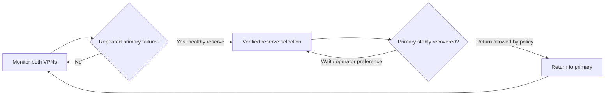

# How Auto VPN works

[Install](INSTALL.en.md) · [Eight setup steps](FIRST-RUN-SETUP.md) · [Current status](CURRENT-STATUS.md)

Monitoring measures DNS/HTTPS through existing router VPNs and displays health, latency, traffic and history. Monitoring alone never changes routes. On the prepared MT3000, explicitly enabled Auto starts the saved primary/reserve profiles and selects traffic using verified observations.

Repeated primary failures with a healthy reserve trigger readiness, worker, current-configuration and rolling-budget checks before a verified switch. Return depends on stable primary recovery and policy. Manual selection works while Auto is on; a healthy operator preference stays preferred. A queue acknowledgement is not completion.

A tunnel is an established VPN connection; the selected channel is the current route for ordinary traffic. Both tunnels may be Connected while one route is selected. Stock firmware may manage servers inside a tunnel; this application coordinates the selected distinct tunnels.

The healthy selected card is green and animated; inactive/error cards are static. Yellow indicates a command/check in progress. Graph levels are primary/reserve/off; missing observations are gaps. Router probes do not prove connectivity for a separate LAN client. Restart requires an explicit Auto Start.
