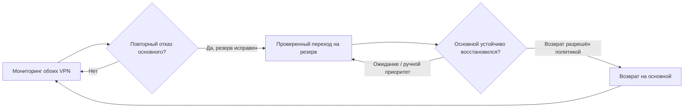

# Как работает Auto VPN

[Установка](INSTALL.ru.md) · [Восемь шагов](FIRST-RUN-SETUP.md) · [Текущее состояние](CURRENT-STATUS.md)

Мониторинг проверяет DNS/HTTPS через существующие VPN роутера и показывает состояние, задержку, трафик и историю. Сам мониторинг маршруты не переключает. На подготовленном MT3000 включённый Auto запускает сохранённые основной и резервный профили и выбирает маршрут по подтверждённым данным.

При повторных отказах основного и исправном резерве контроллер проверяет готовность, фоновые задачи, актуальность конфигурации и лимит попыток, затем выполняет проверяемый переход. Возврат зависит от устойчивого восстановления основного и политики. Ручной выбор доступен и при Auto ON; исправный выбор оператора сохраняет приоритет. Принятый в очередь запрос ещё не означает завершение.

Туннель — установленное соединение VPN; выбранный канал — текущий маршрут обычного трафика. Оба туннеля могут быть Connected, хотя выбран один. Внутри туннеля штатная прошивка может управлять серверами; приложение координирует выбранные разные туннели.

Зелёная исправная выбранная карточка движется; неактивная/ошибочная статична. Жёлтый показывает выполняемую команду или уточнение. Графики имеют только основной/резерв/выключено; отсутствие измерений показано разрывом. Проверки роутера не доказывают доступность отдельного LAN-клиента. После перезапуска Auto требует явного запуска.
