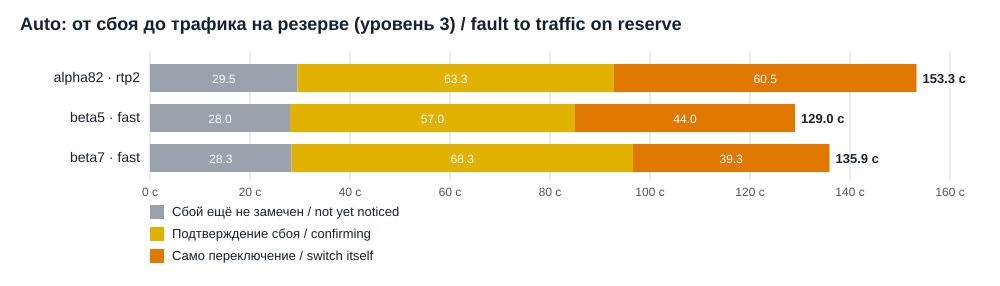
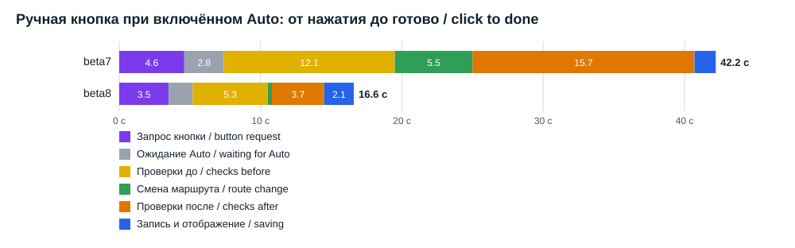

# Switching speed measured on the GL-MT3000

All numbers come from the dedicated GL-MT3000 (OpenWrt 21.02 / GL firmware 4.11). The primary channel is WireGuard and the reserve is OpenVPN. Measured on 30 Oct 2026.

The faults were controlled: the Tests page function blocks the primary's traffic for a fixed time. Times are seconds from the fault start or from the click. Russian version: [MEASUREMENTS.ru.md](MEASUREMENTS.ru.md).

Key numbers:
- Auto: time to traffic on the reserve went from 153 s to 129–136 s.
- The automatic switch itself went from 60 s to 39–44 s.
- The return to the primary is about twice as fast: 50 s to 24–25 s.
- The manual button went from 42 s to 16.6 s (beta8) and then to 9.9 s (beta9) until done, with traffic moved after 8.2 s.

## 1. Speed by version

### Auto: fault start to traffic on the reserve

Probe level 3 with boost, 150 s faults. The values are means.

| Version | How | Runs | Not yet noticed | Confirming | Switch itself | Total to reserve | Return |
|---|---|---|---|---|---|---|---|
| 0.9.1-alpha82 | GL rebuild (rtp2) | 4 | 29.5 s | 63.3 s | 60.5 s | **153.3 s** | 50 s |
| 1.0.0-beta5 | fast switch | 3 of 4 | 28 s | 57 s | 44 s | **129 s** | 23.7 s |
| 1.0.0-beta7 | fast switch | 3 | 28.3 s | 68.3 s | 39.3 s | **136 s** | 25.3 s |

What this shows:
- The fast switch cut the switch itself by about a third and halved the return.
- Most of the time is now detection and confirmation of the failure: about 85–97 s. That time is set by the probe level and the number of required failed checks.
- In beta5, one run in four rolled back because the GL worker was busy (VENDOR-WORKER-BUSY). Beta7 fixes this: the router waits up to 20 s for the GL worker.

### Manual button with Auto on: click to done

| Version | How | Runs | Button request | Waiting for Auto | Checks before | Route change | Checks after and confirmation | Saving and display | Total | Traffic moved at |
|---|---|---|---|---|---|---|---|---|---|---|
| 1.0.0-beta7 | full guarded transaction | 1 | 4.6 s | 2.8 s | 12.1 s | 5.5 s | 15.7 s | 1.5 s | **42.2 s** | ~25 s |
| 1.0.0-beta8 | instant manual switch | 6 | 3.5 s | 1.7 s | 5.3 s | 0.3 s | 3.7 s | 2.1 s | **16.6 s** (14.5–20.2) | 10.8 s (10.1–12.6) |
| 1.0.0-beta9 | click and history in memory | 6 | 3.3 s | 1.4 s | 2.3 s | 1.2 s | 0.7 s | 1.0 s | **9.9 s** (8.2–12.6) | 8.2 s (6.3–11.0) |
| 1.0.0-beta10 | light gate, faster parsing | 6 | 0.6 s | 0.9 s | 1.5 s | 1.1 s | 0.3 s | 0.9 s | **5.4 s** (4.2–6.6) | 4.2 s (3.2–5.3) |

Page buttons (router answer):

| Button | beta9 | beta10 |
|---|---|---|
| Start Auto | 1.06 s | 0.30 s |
| Cancel failure test | 1.04 s | 0.21 s |
| Manual click | 0.9–3.1 s | 0.5–0.8 s |

Beta9 stamps every stage itself:
- checks before the switch: full diagnostic 1.0 s, kernel proof 1.1 s;
- route change: writing the rule order 1.1 s, the atomic kernel switch 0.14–0.27 s.

## 2. Separate experiments

### GL rebuild (rtp2) window, 1.0.0-beta2, 5 cycles

- A switch took 53–60 s, of which the rtp2 rebuild itself took 20–33 s.
- One cycle rolled back with VENDOR-WORKER-BUSY.
- What rtp2 does:
  - swaps the two tunnel jumps in the mangle ROUTE_POLICY chain;
  - rewrites uci route_policy;
  - reloads the firewall (fw3);
  - restarts every dnsmasq, which interrupts DNS for about 2 s.

### Fast rule swap, 5 cycles

The rule was changed by one atomic `iptables-restore --noflush` of the ROUTE_POLICY chain, then old flows were dropped with `conntrack -D`.

- The rule change took 8–33 ms.
- A LAN test client saw the new country after 0.07–1.8 s.
- No request failed and DNS was never interrupted.

## 3. Cost of single steps on the router

Measured idle.

| Step | Time |
|---|---|
| Full pair diagnostic | 0.94–1.13 s |
| Kernel policy attestation | 0.52–0.60 s |
| Manual button controls | 0.62 s |
| Fresh channel probe (DNS + 2 HTTPS) | 0.63 s |
| Kernel fingerprint | 0.27 s |
| python3 start | 0.11 s |
| Application import | 0.71 s |
| Reading the rule order and settings | 0.02 s |
| `uci show` / `iptables-save` | 0.01 s |
| Event history read (1.27 MB, checksummed) | 0.42 s |
| Encoding the history as JSON | 0.19 s |
| Writing 1.27 MB to flash with fsync | 0.11 s |

### Finding: the event history

The history file was 1.27 MB, and every event rewrote it twice: the main file and a full backup copy. That came to about 2.5 MB written to flash and 1.5–2 s per event, with several events per switch.

In 1.0.0-beta9 the Auto service keeps the history in memory, and the backup is made by renaming the previous file instead of writing a second copy. The result is one write per event and half the flash wear.

## 4. What is kept in memory

| Service | Since | Effect |
|---|---|---|
| Page status (status.sock) | 1.0.0-beta7 | Status reply in 0.19 s instead of 0.26–3.1 s |
| Auto wakes up on a click | 1.0.0-beta8 | A click is taken without waiting for the next cycle |
| Manual button through the same service | 1.0.0-beta9 | No Python start per click (3.5 s in beta8). An empty request is answered in 0.15 s. |
| Event history in the Auto service | 1.0.0-beta9 | One flash write per event instead of two full copies, and no re-reading of the file |
| Start/Stop Auto, failure test, probe level and response method through the same service | 1.0.0-beta10 | No Python start per click |
| Light check of a manual click | 1.0.0-beta10 | No rebuild of the whole button model, which took 2.5–6 s under load in beta9 |
| Kernel rule parsing and state reading without repeated work | 1.0.0-beta10 | A profile on the router showed: of a 1.37 s diagnostic, 0.42 s went on checking JSON numbers; of a 0.77 s kernel proof, 0.55 s went on parsing the same rules again |

## 5. Memory used by the services

Total RAM is 480 MB. Measured on 30 Oct 2026.

| Service | beta9, long running | beta10, 6 min after start | Share of RAM |
|---|---|---|---|
| Monitor service (agent) | 45.3 MB | 48.1 MB | ~10% |
| Auto service (native_switch) | 40.0 MB | 41.4 MB | ~9% |
| Sum of the two figures | 85.3 MB | 89.5 MB | ~18% |

How to read these figures (from the router's /proc, beta10):

| Part of one service | Monitor | Auto |
|---|---|---|
| Python and libraries mapped from flash (RssFile) | 6.8 MB | 6.8 MB |
| The service's working memory (RssAnon) | 41.3 MB | 34.6 MB |
| Peak since start (VmHWM) | 52.1 MB | 45.7 MB |

- Python and its libraries (about 7 MB) are physically shared by both services but appear in each figure. The truly unique memory is about 83 MB, not 89.5 MB.
- Working memory is everything a service works with:
  - the observation file and the finished page replies (about 3 MB);
  - the Auto service's copy of the event history (about 8 MB);
  - journals, the latency history, kernel rules and probe data;
  - the Python objects and imported code themselves (about 9 MB per service).
- Python does not return freed memory to the system; it keeps it for reuse. So the figure stays near the working peak: parsing the status, the history and the kernel rules.

A separate measurement of a bare Python process on the router:
- bare Python: 6.5 MB;
- with the program code loaded: 16.3 MB;
- after reading the history: +7.9 MB;
- after the status and the finished reply: +3 MB.

These are parts, not the whole service. The rest is working data and Python's reserve, as described above.

Before the resident copies (beta6 and earlier), the services held about 11 MB less. Peak use while recording an event was the same, because the history was read in full then too.

Safeguard: from beta10, the history copy is kept in memory only while at least 64 MB of RAM is available.

Other resources:
- state files in RAM (/var/run/homensai-vpn): 0.6 MB;
- data on flash (/etc/homensai-vpn): 4.1 MB, of which the history takes 2 × 1.27 MB;
- the flash overlay partition is 18% used (24 of 139 MB).

## 6. Lua line: the Auto supervisor in Lua (2.0.0-alpha3/alpha4, 31 Oct 2026)

Same MT3000 and channels. Compared with Python 1.0.0-beta13. The Auto supervisor runs in Lua 5.1 (`option lua_auto '1'`); monitoring and the page stay in Python.

| | Python (beta13) | Lua (alpha3) |
|---|---|---|
| Idle Auto, CPU (240 s window) | 55.7 % of a core | **22.5 %** (alpha3) → **15.7 %** (alpha6: 12.4 % itself + 3.3 % child processes) |
| Auto, memory (RSS) | 40.6 MB | **12.1 MB** (alpha3) → **9.1 MB** (alpha6) |
| Manual button: traffic on the new channel | 4.1 s | **2.6 s** (1.9–3.6), 6 of 6 |
| Manual button: done | 5.5 s | **4.0 s** (3.3–4.9) |

Automatic faults (150 s fault of the primary, probe level unchanged), Lua alpha3:

| Fault | Detected | Switch started | Reserve confirmed | Back on the primary |
|---|---|---|---|---|
| 1 | 41 s | 76 s | 97 s | 216 s |
| 2 | 13 s | 44 s | 65 s | 211 s |

Resilience (alpha4): `kill -9` of the Lua process during APPLYING — procd restarted it after 5 s, the journal was rolled back 9.5 s after the kill (SUPERVISOR-RECOVERY), the pair cleanup finished and the LAN guard was removed. Auto is off afterwards — by design, as in Python (a restarted supervisor never resumes the intent). Stop during APPLYING (alpha6): the switch was rolled back after 5 s, the cleanup finished, Auto stopped, the LAN guard was removed, the Lua process was not restarted.

Where Lua's CPU went (alpha5 profiler, 60 s): ~40 % parsing the monitor's `status.json` (230 KB every 10.5 s, the exact Lua parser takes 360 ms, and it ran twice). alpha5 parses once per file version, alpha6 builds only the 7 fields the supervisor reads (170 ms). The rest: the GL process check in `/proc` (~9 %), JSON encoding and Python number format (~10 %), the kernel rule proof (~8 %). The next step is plan item 8 (monitor and Auto in one process, no file between them).

Monitor in Lua (items 2–3, alpha9, same conditions: level 1, a probe every 60 s): CPU 3.4 % of a core against 4.6 % for the Python monitor, memory 8 MB against ~37 MB, `status` answer 0.09 s against 0.14 s. Both services in Lua together: ~22 MB against ~78 MB for the two Python services. Until the buttons move to Lua (item 4) they go through `agent.py`, so a manual switch is slower: done after 6.0 s (4.0 s with the Python monitor).

Item 4, first step (alpha10–11, both services in Lua): the manual click request is answered by the Lua monitor in 0.04 s; traffic on the new channel after 2.7–2.9 s, done after 5.0–5.3 s (3+3). In the hold after a manual switch the Lua supervisor uses 15.6 % of a core (alpha10: 37.6 %, every re-check of the held channel started Python). Both services in Lua together at idle: about 19 % of a core and ~20 MB against ~60 % and ~78 MB for the two Python services.

What the first router runs found (and the PC tests with a fake system layer could not): quotes in the LAN guard release job, nixio argument forms (modes as strings, open flags), no `stat` command, the stdin of the in-process network write script. All fixed; a router self-test of the system layer (17 checks) now runs before Lua is enabled.
