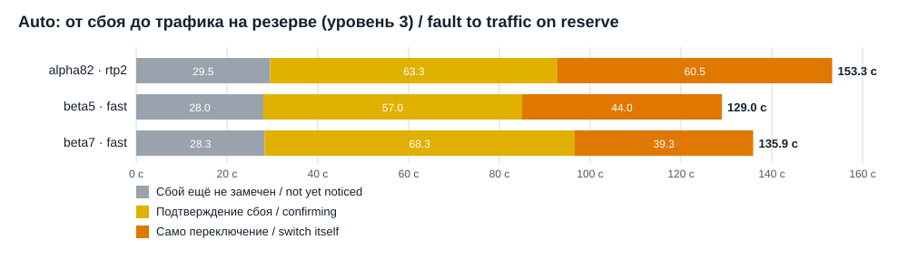
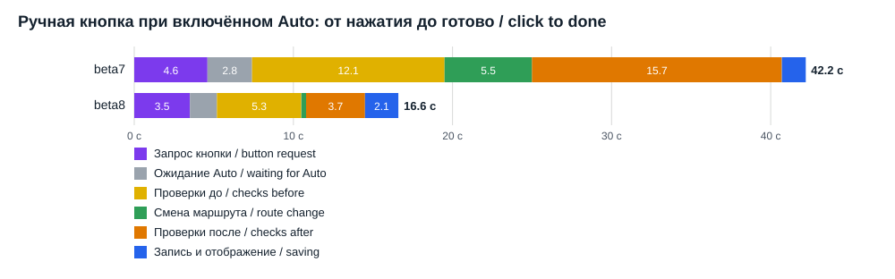

# Замеры скорости переключения на GL-MT3000

**Лицензия:** [HomenSAI Personal & Commercial Source License v1.0](../LICENSE) — исходный код доступен, но это не open source. Более ранние версии под MIT сохраняют права MIT ([LICENSE-MIT-LEGACY](../LICENSE-MIT-LEGACY), [подробнее](../LICENSING.md)).

Все цифры сняты на выделенном GL-MT3000 (OpenWrt 21.02 / прошивка GL 4.11). Основной канал — WireGuard, резервный — OpenVPN. Дата замеров — 30.10.2026.

Сбои контролируемые: функция страницы «Тесты» блокирует трафик основного канала на заданное время. Время считается в секундах от начала сбоя или от нажатия кнопки.

Главные цифры:
- Auto: время до трафика на резерве сократилось со 153 до 129–136 с.
- Само автоматическое переключение стало короче: 60 → 39–44 с.
- Возврат на основной стал примерно вдвое быстрее: 50 → 24–25 с.
- Ручная кнопка: от нажатия до готово — 42 → 16,6 (beta8) → 9,9 с (beta9). Трафик переходит через 8,2 с.

Эти главные цифры и разделы 1–5 описывают Python-линию 30.10.2026 и остаются как запись. Текущая линия 2.0.0-alpha24 (службы Lua, модуль JSON на C, быстрое обнаружение) — в [разделе 7](#7-линия-lua-после-alpha6-200-alpha13--alpha24-31102026) и [разделе 8, пирамида выполнения и время переключения](#8-пирамида-выполнения-и-время-переключения): ручное переключение готово примерно за 0,7 с, решение Auto — через 26–28 с после сбоя.

## 1. Скорость по версиям

### Auto: от начала сбоя до трафика на резерве

Уровень опроса 3, с ускорением, сбой 150 с. Указаны средние значения.

| Версия | Способ | Прогонов | Сбой ещё не замечен | Подтверждение сбоя | Само переключение | Итого до резерва | Возврат на основной |
|---|---|---|---|---|---|---|---|
| 0.9.1-alpha82 | перестройка GL (rtp2) | 4 | 29,5 с | 63,3 с | 60,5 с | **153,3 с** | 50 с |
| 1.0.0-beta5 | быстрое переключение | 3 из 4 | 28 с | 57 с | 44 с | **129 с** | 23,7 с |
| 1.0.0-beta7 | быстрое переключение | 3 | 28,3 с | 68,3 с | 39,3 с | **136 с** | 25,3 с |

Что видно:
- Быстрое переключение сократило само переключение примерно на треть, а возврат — вдвое.
- Основное время теперь занимают обнаружение и подтверждение сбоя: около 85–97 с. Это время задаётся уровнем опроса и числом обязательных неудачных проверок.
- В бете5 один прогон из четырёх откатился, потому что был занят обработчик GL (VENDOR-WORKER-BUSY). В бете7 это исправлено: роутер ждёт обработчик GL до 20 с.

### Ручная кнопка при включённом Auto: от нажатия до готово

| Версия | Способ | Прогонов | Запрос кнопки | Ожидание Auto | Проверки до | Смена маршрута | Проверки после и подтверждение | Запись и отображение | Итого | Трафик перешёл через |
|---|---|---|---|---|---|---|---|---|---|---|
| 1.0.0-beta7 | полная защищённая транзакция | 1 | 4,6 с | 2,8 с | 12,1 с | 5,5 с | 15,7 с | 1,5 с | **42,2 с** | ~25 с |
| 1.0.0-beta8 | мгновенное ручное переключение | 6 | 3,5 с | 1,7 с | 5,3 с | 0,3 с | 3,7 с | 2,1 с | **16,6 с** (14,5–20,2) | 10,8 с (10,1–12,6) |
| 1.0.0-beta9 | нажатие и история в памяти | 6 | 3,3 с | 1,4 с | 2,3 с | 1,2 с | 0,7 с | 1,0 с | **9,9 с** (8,2–12,6) | 8,2 с (6,3–11,0) |
| 1.0.0-beta10 | облегчённая проверка, быстрый разбор | 6 | 0,6 с | 0,9 с | 1,5 с | 1,1 с | 0,3 с | 0,9 с | **5,4 с** (4,2–6,6) | 4,2 с (3,2–5,3) |

Кнопки страницы (ответ роутера):

| Кнопка | beta9 | beta10 |
|---|---|---|
| Старт Auto | 1,06 с | 0,30 с |
| Отмена теста сбоя | 1,04 с | 0,21 с |
| Ручное нажатие | 0,9–3,1 с | 0,5–0,8 с |

В бете9 роутер записывает время каждого этапа сам. Подробности по этапам:
- проверки до переключения: полная диагностика 1,0 с, проверка ядра 1,1 с;
- смена маршрута: запись порядка каналов 1,1 с, атомарное переключение в ядре 0,14–0,27 с.

Бета9 по отдельным переключениям:

| Направление | Запрос | Ожидание | Проверки до | Смена маршрута | Проверки после | Запись | Трафик перешёл | Готово |
|---|---|---|---|---|---|---|---|---|
| на резерв | 2,59 | 0,04 | 2,31 | 1,33 | 0,81 | 1,17 | 6,27 | 8,23 |
| на основной | 2,60 | 0,64 | 2,42 | 1,20 | 0,63 | 0,98 | 6,90 | 8,47 |
| на резерв | 2,95 | 2,68 | 2,16 | 1,18 | 0,64 | 0,98 | 9,01 | 10,58 |
| на основной | 6,26 | 1,26 | 2,21 | 1,19 | 0,63 | 1,09 | 10,96 | 12,64 |
| на резерв | 2,52 | 3,09 | 2,21 | 1,34 | 0,77 | 1,05 | 9,20 | 10,98 |
| на основной | 2,94 | 0,70 | 2,20 | 1,19 | 0,63 | 1,03 | 6,99 | 8,68 |

Бета8 по отдельным переключениям:

| Направление | Запрос | Ожидание | Проверки до | Смена маршрута | Проверки после | Запись | Трафик перешёл | Готово |
|---|---|---|---|---|---|---|---|---|
| на резерв | 3,45 | 3,11 | 5,64 | 0,37 | 4,17 | 3,47 | 12,57 | 20,21 |
| на основной | 3,47 | 2,35 | 4,92 | 0,34 | 3,48 | 1,00 | 11,08 | 15,56 |
| на резерв | 3,51 | 0,59 | 5,92 | 0,35 | 3,79 | 2,91 | 10,37 | 17,07 |
| на основной | 3,53 | 1,14 | 5,04 | 0,34 | 3,47 | 1,00 | 10,05 | 14,52 |
| на резерв | 3,63 | 1,24 | 5,21 | 0,25 | 3,91 | 3,20 | 10,33 | 17,44 |
| на основной | 3,48 | 1,79 | 4,93 | 0,33 | 3,47 | 1,01 | 10,53 | 15,01 |

Все значения в секундах.

## 2. Отдельные эксперименты

### Окно перестройки GL (rtp2), 1.0.0-beta2, 5 циклов

- Переключение заняло 53–60 с, из них сама перестройка rtp2 — 20–33 с.
- Один цикл откатился с VENDOR-WORKER-BUSY.
- Что делает rtp2:
  - меняет местами два перехода в цепочке mangle ROUTE_POLICY;
  - переписывает uci route_policy;
  - перезагружает firewall (fw3);
  - перезапускает все dnsmasq, отчего DNS прерывается примерно на 2 с.

### Быстрая замена правила, 5 циклов

Правило менялось одним атомарным `iptables-restore --noflush` цепочки ROUTE_POLICY, после чего старые соединения сбрасывались через `conntrack -D`.

- Смена правила занимала 8–33 мс.
- Тестовый клиент в локальной сети увидел новую страну через 0,07–1,8 с.
- Ни одного неудачного запроса не было, DNS работал без перерыва.

## 3. Стоимость отдельных шагов на роутере

Замер в покое.

| Шаг | Время |
|---|---|
| Полная диагностика пары каналов | 0,94–1,13 с |
| Проверка правил ядра (attest) | 0,52–0,60 с |
| Кнопки ручного переключения (controls) | 0,62 с |
| Свежая проба канала (DNS + 2 HTTPS) | 0,63 с |
| Отпечаток ядра | 0,27 с |
| Запуск python3 | 0,11 с |
| Импорт программы (agent) | 0,71 с |
| Чтение порядка правил / настроек | 0,02 с |
| `uci show` / `iptables-save` | 0,01 с |
| Чтение истории событий (1,27 МБ, с проверкой суммы) | 0,42 с |
| Кодирование истории в JSON | 0,19 с |
| Запись 1,27 МБ на флеш с fsync | 0,11 с |

### Находка: история событий

Файл истории занимал 1,27 МБ, и каждое событие перезаписывало его дважды: основной файл и полную резервную копию. Получалось около 2,5 МБ записи на флеш и 1,5–2 с на одно событие, а событий при одном переключении несколько.

В 1.0.0-beta9 служба Auto держит историю в памяти. Резервная копия получается переименованием предыдущего файла, а не второй записью. Итог: одна запись на событие, флеш изнашивается вдвое меньше.

## 4. Что держится в памяти

| Служба | С версии | Что даёт |
|---|---|---|
| Статус для страницы (status.sock) | 1.0.0-beta7 | Ответ статуса за 0,19 с вместо 0,26–3,1 с |
| Немедленное пробуждение Auto по нажатию | 1.0.0-beta8 | Нажатие кнопки берётся без ожидания следующего цикла |
| Нажатие ручной кнопки через ту же службу | 1.0.0-beta9 | Не нужно каждый раз запускать Python (в бете8 это было 3,5 с). Пустой запрос отвечает за 0,15 с. |
| История событий у службы Auto | 1.0.0-beta9 | Одна запись на флеш на событие вместо двух полных копий, без повторного чтения файла |
| Кнопки Старт/Стоп Auto, тест сбоя, уровень опроса и способ отклика через ту же службу | 1.0.0-beta10 | Python не запускается на каждое нажатие |
| Облегчённая проверка ручного нажатия | 1.0.0-beta10 | Без пересчёта всей модели кнопок: в бете9 это занимало 2,5–6 с под нагрузкой |
| Разбор правил ядра и чтение файлов состояния без лишней работы | 1.0.0-beta10 | Профиль на роутере показал: из 1,37 с диагностики 0,42 с уходило на проверку чисел в JSON, а из 0,77 с проверки ядра 0,55 с — на повторный разбор тех же правил |

## 5. Сколько памяти занимают службы

Всего оперативной памяти 480 МБ. Замер 30.10.2026.

| Служба | beta9, давно работает | beta10, через 6 мин после старта | Доля ОЗУ |
|---|---|---|---|
| Служба мониторинга (agent) | 45,3 МБ | 48,1 МБ | ~10 % |
| Служба Auto (native_switch) | 40,0 МБ | 41,4 МБ | ~9 % |
| Сумма двух чисел | 85,3 МБ | 89,5 МБ | ~18 % |

Как читать эти числа (по данным /proc роутера, beta10):

| Часть одной службы | Мониторинг | Auto |
|---|---|---|
| Python и библиотеки, отображённые с флеша (RssFile) | 6,8 МБ | 6,8 МБ |
| Рабочая память службы (RssAnon) | 41,3 МБ | 34,6 МБ |
| Пик с момента старта (VmHWM) | 52,1 МБ | 45,7 МБ |

- Python и библиотеки (около 7 МБ) физически общие для обеих служб, но входят в число каждой. Реально уникальной памяти около 83 МБ, а не 89,5.
- Рабочая память — это всё, с чем служба работает:
  - файл наблюдений и готовые ответы страницы (около 3 МБ);
  - копия истории событий у службы Auto (около 8 МБ);
  - журналы, история задержек, правила ядра, данные проверок;
  - сами объекты Python и импортированный код (около 9 МБ на службу).
- Python не возвращает системе освобождённую память, а держит её для повторного использования. Поэтому число держится около пика работы: разбор статуса, истории, правил ядра.

Отдельный замер чистого процесса Python на роутере:
- пустой Python — 6,5 МБ;
- с загруженным кодом программы — 16,3 МБ;
- после чтения истории — +7,9 МБ;
- после статуса и готового ответа — +3 МБ.

Это составные части, а не вся служба. Остальное — рабочие данные и запас Python, описанные выше.

До постоянных копий в памяти (beta6 и раньше) службы держали примерно на 11 МБ меньше. Пик при записи события был таким же, потому что история и тогда читалась целиком.

Защита: с beta10 копия истории держится в памяти, только пока свободно не меньше 64 МБ.

Прочие ресурсы:
- файлы состояния в ОЗУ (/var/run/homensai-vpn): 0,6 МБ;
- данные на флеше (/etc/homensai-vpn): 4,1 МБ, из них история 2 × 1,27 МБ;
- раздел флеша overlay занят на 18 % (24 из 139 МБ).

## 6. Линия Lua: супервизор Auto на Lua (2.0.0-alpha3/alpha4, 31.10.2026)

Тот же MT3000 и те же каналы. Сравнение с Python 1.0.0-beta13. Супервизор Auto работает на Lua 5.1 (`option lua_auto '1'`); мониторинг и страница — на Python.

| | Python (beta13) | Lua (alpha3) |
|---|---|---|
| Auto в покое, процессор (окно 240 с) | 55,7 % ядра | **22,5 %** (alpha3) → **15,7 %** (alpha6: 12,4 % сам + 3,3 % дочерние процессы) |
| Auto, память (RSS) | 40,6 МБ | **12,1 МБ** (alpha3) → **9,1 МБ** (alpha6) |
| Ручная кнопка: трафик на новом канале | 4,1 с | **2,6 с** (1,9–3,6), 6 из 6 |
| Ручная кнопка: готово | 5,5 с | **4,0 с** (3,3–4,9) |

Автосбои (сбой основного 150 с, уровень опроса не менялся), Lua alpha3:

| Сбой | Сбой замечен | Начало переключения | Резерв подтверждён | Снова на основном |
|---|---|---|---|---|
| 1 | 41 с | 76 с | 97 с | 216 с |
| 2 | 13 с | 44 с | 65 с | 211 с |

Устойчивость (alpha4): `kill -9` процесса Lua во время APPLYING — procd перезапустил его через 5 с, журнал откатан через 9,5 с после kill (SUPERVISOR-RECOVERY), уборка пары завершена, защита LAN снята. Auto после этого выключен — так задумано и в Python (после перезапуска супервизора намерение не возобновляется). Stop во время APPLYING (alpha6): переключение откатано через 5 с, уборка завершена, Auto остановлен, защита LAN снята, процесс Lua не перезапускался.

Куда уходил процессор Lua (профилировщик alpha5, 60 с): ~40 % — разбор `status.json` монитора (230 КБ каждые 10,5 с, точный разбор на Lua 360 мс, и он выполнялся дважды). alpha5 — один разбор на версию файла, alpha6 — только 7 полей, которые читает супервизор (170 мс). Остальное: проверка процессов GL в `/proc` (~9 %), кодирование JSON и формат чисел Python (~10 %), проверка правил ядра (~8 %). Дальнейшее сокращение — пункт 8 плана (монитор и Auto в одном процессе, без файла между ними).

Монитор на Lua (пункты 2–3, alpha9, одинаковые условия: уровень 1, проверка раз в 60 с): процессор 3,4 % ядра против 4,6 % у Python-монитора, память 8 МБ против ~37 МБ, ответ `status` 0,09 с против 0,14 с. Обе службы на Lua вместе: ~22 МБ против ~78 МБ у двух Python-служб. Пока кнопки идут через `agent.py`, ручное переключение медленнее: готово 6,0 с (с Python-монитором 4,0 с) — до пункта 4.

Пункт 4, первый шаг (alpha10–11, обе службы на Lua): запрос ручной кнопки принимает Lua-монитор за 0,04 с; трафик на новом канале через 2,7–2,9 с, готово через 5,0–5,3 с (3+3). В удержании после ручного переключения Auto на Lua — 15,6 % ядра (alpha10 — 37,6 %: каждая перепроверка удерживаемого канала запускала Python). Обе службы на Lua вместе в покое — около 19 % ядра и ~20 МБ против ~60 % и ~78 МБ у двух Python-служб.

Что нашли первые запуски на роутере (и чего не видели тесты на ПК с подменой системного слоя): кавычки в задании снятия защиты LAN, формы аргументов nixio (права строкой, флаги open), отсутствие команды `stat`, stdin встроенного скрипта записи сети. Все исправлены; самопроверка системного слоя на роутере (17 проверок) теперь запускается перед включением Lua.

## 7. Линия Lua после alpha6 (2.0.0-alpha13 — alpha24, 31.10–01.11.2026)

Тот же MT3000 и те же каналы. Источники — примечания к версиям 2.0.0-alpha17…alpha24 и датированные отчёты в `docs/architecture/` ([SOAK-LUA-VS-C](architecture/SOAK-LUA-VS-C-2026-11-01.ru.md), [SWITCH-SPEED](architecture/SWITCH-SPEED-2026-11-01.ru.md), [VENDOR-SETTLING](architecture/VENDOR-SETTLING-2026-11-01.ru.md), [HISTORY-JOURNAL](architecture/HISTORY-JOURNAL-2026-11-01.ru.md)). Ручное переключение на резерв и обратно, запрос `status` раз в секунду.

Ручное переключение, две службы на Lua:

| Версия | Что изменилось | Трафик переключился | Переключение готово | Самый долгий `status` при переключениях |
|---|---|---|---|---|
| alpha16 | исходный уровень | 3,7 с | 7,2–7,4 с | 8 из 49 ответов дольше 1 с |
| alpha19 | история кодируется один раз на событие | 1,4–1,6 с | 2,5–2,9 с | 2,0–2,2 с (6 из 40 дольше 1 с) |
| alpha20 | проекцию истории строит дочерний процесс | 1,4–1,7 с | 2,6–3,4 с | 0,42–0,50 с |
| alpha21, чистый Lua | журнал истории, кэш диагностики | 0,6–0,8 с | 1,05–1,3 с | 0,15 с |
| alpha21, с C (`canon_c.so`) | модуль C для канонического JSON | 0,5 с | 0,7 с | 0,09 с |
| alpha22, две службы (по умолчанию) | то же | 0,49–0,59 с | 0,71–0,81 с | 0,12–0,14 с |
| alpha22, один процесс `hv-core` | необязательный | 0,48–0,61 с | 0,81–0,94 с | 0,13–0,26 с |

Процессор Auto: 14–15 % (alpha20), 10,1 % (alpha21 чистый Lua), 7,8 % (alpha21 с C). Память обеих служб: около 36 МБ (alpha20), около 18 МБ (alpha21). `hv-core` экономит ещё около 5 МБ (около 15,5 МБ против около 20,5 МБ, alpha22).

Автоматическое переключение после сбоя (основной WireGuard отрезан на 150 с, уровень опроса 1, MT3000, alpha23, время от начала сбоя):

| | Начало плотных проверок | Решение Auto (APPLYING) | Трафик на резерве | Подтверждено (COMMITTED) |
|---|---|---|---|---|
| Быстрое обнаружение выключено, ускорение уже шло | нет | 29,5 с | 31,0 с | 36,3 с |
| Быстрое обнаружение включено, ускорение шло | 2,6 с | 25,8 с | 27,4 с | 32,1 с |
| Быстрое обнаружение включено, с нуля | 3,1 с | 28,2 с | 29,5 с | 35,2 с |
| Для сравнения: 3-часовые тесты, с нуля, без быстрого обнаружения | нет | 58–88 с | не измерялось | не измерялось |

- От решения до ухода трафика проходит 1,3–1,6 с (проверка и подтверждение ядра около 0,5 с, UCI около 0,5 с, iptables около 0,5 с). Ещё 3–5 с до COMMITTED идут после ухода трафика (резерв проверяется через новый путь).
- Остальные примерно 23 с — три неудачные полные проверки подряд (правило `failures`, по умолчанию 3). Каждая проверка отрезанного канала ждёт истечения времени DNS и HTTPS.
- С alpha24 быстрое обнаружение включено по умолчанию, ожидание HTTPS в проверках монитора при плотном подтверждении — 3 с вместо 6 с, срок успокоения прошивки — не больше 45 с. Эти два изменения alpha24 **на роутере ещё не измерены**; таблица выше — alpha23.

Автоматическое переключение в 3-часовых тестах (сбой каждые 3 минуты, от APPLYING до COMMITTED): Lua alpha20 — 5,0–8,0 с (медиана 6,05 с); с C, alpha21 — 4,4–7,8 с (медиана 4,6 с). Вне окна внешней аварии провайдера alpha21 с C прошла 33 цикла из 33 в штатной работе (alpha20 на Lua: 39 из 46).

Отключение питания (мгновенная перезагрузка `sysrq-b`, не физическое выдёргивание вилки):
- alpha22, ручное переключение прервано при журнале APPLYING: 2 из 2 восстановились сами. Журнал закончился ROLLED-BACK (SUPERVISOR-RECOVERY), Start не понадобился, Auto был в OBSERVING на основном канале через 255 с после загрузки, в LAN был интернет, защита «только VPN» стояла.
- В 3-часовых тестах время от перезагрузки до штатной работы — 235–563 с (Lua alpha20) и 258–498 с (alpha21 с C).

Ожидание прошивки после пересборки туннеля (`VENDOR-SETTLING`):
- Тесты, уровень опроса 1: около 120 с на пересборку, наблюдалось от 0 до 228 с.
- alpha23 (более частые проходы монитора, вариант А): 119–139 с. Вариант А почти ничего не дал: срок успокоения 120 с остаётся главным.
- alpha24 (срок успокоения не больше 45 с, вариант Б): не измерялось.

История переключений журналом (schema 2, alpha21). Замер на x86 в образе Docker с Python 3.11 и Lua 5.1 (не на роутере), 1285 событий за 7 дней:

| | schema 1 (alpha20) | schema 2 (журнал) |
|---|---|---|
| Файл, который читает страница | 899,6 КБ | 134,4 КБ (состояние) |
| Архив событий | нет | 978,8 КБ |
| Python, запись одного события | 93,2 мс | 35,2 мс |
| Lua, запись одного события (CPU / стена) | 102,4 / 119,4 мс | 23,6 / 35,4 мс |

Запись на флеш на событие: было около 0,9 МБ, стало около 134 КБ состояния и одна строка архива около 760 байт. Модуль JSON на C в эмуляторе aarch64 на документе истории 1 МБ: сборка быстрее в 5,5 раза, разбор — в 18 раз; на настоящих файлах роутера (только чтение) разбор быстрее в 10–12 раз, сборка — в 4–7 раз, вывод байт-в-байт как у Lua.

## 8. Пирамида выполнения и время переключения

Каждый уровень работает с теми же файлами и по тем же правилам; при отказе вышестоящего уровня работу берёт нижестоящий. Время — задокументированные замеры на MT3000 выше. «Не измерялось» означает, что в документах проекта нет такого числа; оценок здесь нет. Цифры Python взяты со старых версий (1.0.0-beta5…beta13, для автосбоев — уровень опроса 3 с ускорением) и не являются сравнением «в равных условиях» с цифрами Lua.

| Уровень | Что на нём работает | Ручное переключение: трафик / готово | Автоматически: решение Auto после сбоя | Автоматически: трафик после решения | Отключение питания посреди переключения |
|---|---|---|---|---|---|
| C + Lua (по умолчанию, `canon_c.so` включён) | монитор и Auto на Lua 5.1 — две службы (необязательно один процесс `hv-core`); модуль C считает канонический JSON внутри Lua | 0,5 с / 0,7 с (alpha21); 0,49–0,59 с / 0,71–0,81 с (alpha22) | 26–28 с с быстрым обнаружением на уровне опроса 1 (25,8–29,5 с в таблице); раньше 58–88 с | 1,3–1,6 с | восстановление само, 2 из 2; штатная работа через 255 с после загрузки (тесты: 258–498 с) |
| Чистый Lua (`HOMENSAI_CANON_C=0`, либо модуль не загрузился или не прошёл самопроверку) | те же службы Lua, канонический JSON на Lua | 0,6–0,8 с / 1,05–1,3 с (alpha21) | не измерялось (быстрое обнаружение измеряли с включённым модулем C) | не измерялось | для alpha21 не измерялось; тест только на Lua, alpha20: 235–563 с до штатной работы |
| Запасной уровень Python (Python 3.9, `agent.py` и `native_switch.py`; работает, если параметры Lua выключены, или после `LUA-AUTO-FALLBACK`) | всё на Python | 4,1 с / 5,5 с (1.0.0-beta13); при включённом Auto 3,2–5,3 с / 4,2–6,6 с (прогоны 1.0.0-beta10) | 129–136 с от сбоя до трафика на резерве (средние 1.0.0-beta5 и beta7), из них само переключение 39–44 с; быстрое обнаружение на Python: не измерялось | входит в 39–44 с выше | не измерялось |

Примечания:
- Быстрое обнаружение (`option lua_fast_detect '0'` выключает его), ожидание HTTPS 3 с и срок успокоения прошивки 45 с — правила и Python-, и Lua-ядра, но быстрое обнаружение измеряли только на ядре Lua с модулем C, а изменения 3 с и 45 с не измеряли вовсе.
- С 2.0.0-alpha24 службы Lua и быстрое обнаружение включены по умолчанию (решение владельца: самая быстрая измеренная конфигурация); `option lua_monitor '0'` / `option lua_auto '0'` запускают службы Python. Переходы вниз и их коды: `HV-CORE-FALLBACK`, `LUA-AUTO-FALLBACK`.
- Нигде в документах проекта не измерено: физическое отключение питания, суточный прогон текущей сборки, время передачи работы при `LUA-AUTO-FALLBACK`, MT6000.
