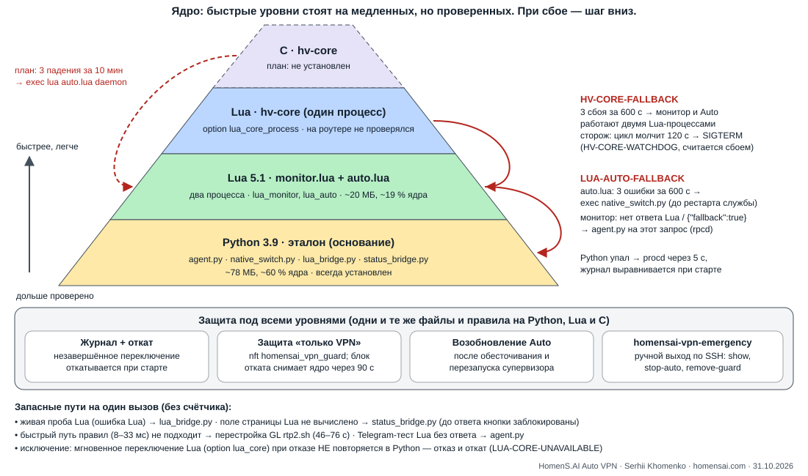

<!-- doc-role: design -->
# Ядро программы: уровни Python → Lua → C и переходы при сбое

HomenS.AI Auto VPN · Serhii Khomenko · https://homensai.com · MIT

Дата: 31.10.2026 · Ветка: `lua/agent-pyramid-20261031` (от интеграции alpha14) · Связанные документы: [LUA-PLAN-2026-10-30.ru.md](LUA-PLAN-2026-10-30.ru.md), [LUA-HVCORE-ITEM8-2026-10-31.ru.md](LUA-HVCORE-ITEM8-2026-10-31.ru.md), [POWER-CUT-INTEGRITY-2026-10-31.ru.md](POWER-CUT-INTEGRITY-2026-10-31.ru.md), [MASTER-PLAN-2026-10-31.ru.md](MASTER-PLAN-2026-10-31.ru.md), замеры — [MEASUREMENTS.ru.md](../MEASUREMENTS.ru.md). Проект C — `c/DESIGN.ru.md` и `c/README.ru.md` в ветке `feat/c-core-20261031` (в этой ветке их нет).

Пометки: **[Ф]** — факт (код этой ветки, тест на ПК или замер на MT3000 с датой), **[О]** — оценка, **[П]** — проверить на роутере.

Документ описывает то, что есть в коде. Каждое число и каждый код ниже найдены в исходниках этой ветки (путь указан); где описание задачи расходилось с кодом, прав код — расхождения собраны в §7. Встроенная помощь показывает ту же схему коротко: тема «Ядро программы» (`router/core_help.inc.js`).

## 1. Пирамида



```
                 ┌───────────┐
                 │  C hv-core │  план: собран, проверен на MT3000 только чтением, не установлен
                 └─────┬─────┘
          (план) 3 падения за 10 мин ─────────────┐
           ┌───────────┴───────────┐              │
           │ Lua hv-core: 1 процесс │  option lua_core_process (по умолчанию выкл.)
           └───────────┬───────────┘              │
     HV-CORE-FALLBACK: 3 сбоя за 600 с            │
      ┌────────────────┴────────────────┐         │
      │ Lua 5.1: monitor.lua + auto.lua │ ◄───────┘   option lua_monitor / lua_auto (по умолчанию выкл.)
      └────────────────┬────────────────┘
  LUA-AUTO-FALLBACK: 3 ошибки за 600 с (Auto); нет ответа Lua → agent.py (каждый запрос страницы)
 ┌─────────────────────┴──────────────────────┐
 │ Python 3.9: agent.py, native_switch.py,     │  эталон; всегда установлен; последний уровень
 │ lua_bridge.py, status_bridge.py             │
 └─────────────────────┬──────────────────────┘
 ════════════ защита под всеми уровнями (общие файлы и правила) ════════════
  журнал + откат + восстановление при старте · защита «только VPN» (nft) ·
  возобновление Auto после обесточивания/перезапуска · homensai-vpn-emergency
```

Вверх — быстрее и легче (меньше процессора и памяти на слабом роутере). Вниз — медленнее, но дольше проверено. Переход всегда идёт **на один уровень вниз** и только по коду, который виден в журнале системы (`logread -e homensai`) и в файле в ОЗУ (`/var/run/homensai-vpn/…`).

## 2. Уровни

### 2.1 Python 3.9 — основание (эталон)

| Процесс / модуль | Роль |
|---|---|
| `agent.py daemon` (procd-экземпляр `monitor`) | монитор: пробы каналов, `status.json`, учёт, ответы странице (rpcd `homensai-vpn`) |
| `native_switch.py daemon` (экземпляр `native`) | супервизор Auto: журнал транзакции, переключение, откат, пара, ручная кнопка |
| `lua_bridge.py probe/trace` | живая проба канала для Lua-супервизора (запасной путь) |
| `status_bridge.py` | поля страницы для Lua-монитора (запасной путь) |
| `status_client.py` | лёгкий клиент `status.sock` при Python-мониторе |

Это выпущенный код 1.0.0 с самой длинной историей проверок на MT3000 и MT6000. Lua-модули — порт «один в один»: те же файлы, те же форматы байт в байт (канонический JSON с `repr(float)` Python), те же коды отказов. Дифференциальные тесты на ПК (`router/tests/test_lua_*.py`, docker `homensai-vpn-python39:local`) сверяют Lua с Python на одинаковых входах. Python всегда в пакете: init-скрипт выбирает его, если флаг Lua выключен, если флаг неверный или если файлов Lua нет (`router/files/etc/init.d/homensai-vpn`).

### 2.2 Lua 5.1 — два процесса

| Флаг (`/etc/config/homensai_vpn`) | Что запускается вместо Python | Условие в init-скрипте |
|---|---|---|
| `option lua_monitor '1'` | `lua monitor.lua daemon` (экземпляр `monitor`) | есть `lua/monitor.lua` |
| `option lua_auto '1'` | `lua auto.lua daemon` (экземпляр `native`) | есть `/usr/bin/lua`, `lua/auto.lua`, `lua/backend.lua`; режим не monitor-only |
| `option lua_probe '0'` (по умолчанию проба в Lua) | живая проба через `lua_bridge.py` | `lua/backend.lua`, `B.native_probe_enabled` |
| `option lua_core '1'` | запись мгновенного ручного переключения — `lua/instant_switch.lua` из Python-супервизора | `native_switch.lua_core_enabled` |

Оба супервизора (Python и Lua) берут `native.lock`, поэтому одновременно работать не могут. Журнал, ревизия управления, состояние пары, история — общие файлы, поэтому смена уровня безопасна в любой момент (проверено Lua↔Python [Ф], см. LUA-AUTO-ITEM1).

### 2.3 Lua hv-core — один процесс

`option lua_core_process '1'` — монитор и Auto в одном процессе `lua hv_core.lua daemon` (экземпляр `monitor`); экземпляр `native` — `hv_core.lua standby`: сторож и запасной Auto. Включается только если уже включены и установлены обе Lua-половины, иначе флаг игнорируется. Код и тесты готовы на ПК; **на роутере не запускался** [Ф, LUA-HVCORE-ITEM8].

### 2.4 C hv-core — план

Ветка `feat/c-core-20261031`: полная логика монитора и Auto на C (24 набора тестов на ПК, ASan/UBSan, дифференциальный тест канонического JSON против Python — 0 расхождений). Собран для aarch64; на MT3000 выполнена только проверка чтением (`hv-core check` против Lua-бэкенда, `private/c-build/out/ckit-router-20261031.json`): **18 значений совпали, 2 различаются** (`blockers`, `terms_version`) [Ф, 31.10.2026]. Динамическая сборка не запустилась (`libubus.so.20210630` нет — в прошивке другая ABI), статическая — запускается. В пакет не входит, флаг (`option c_core '1'`) ещё не существует в init-скрипте.

## 3. Цена уровней (замеры)

| | Python 3.9 | Lua, два процесса | Lua hv-core | C hv-core |
|---|---|---|---|---|
| Память служб | 85,3 МБ RSS (монитор 45,3 + Auto 40,0) [Ф 30.10.2026]; ~78 МБ в сравнении с Lua | ~20 МБ (монитор ~8 + Auto 9,1) [Ф alpha6–11] | ПК: 7,1 МБ RSS обе половины [Ф x86_64]; роутер: ожидание −3…5 МБ Pss к двум процессам [О] | `hv-core check` на MT3000: VmRSS 4,4 МБ (Lua-бэкенд тем же check: 5,9 МБ) [Ф]; цель в работе < 2 МБ [О] |
| Процессор в покое | ~60 % ядра обе службы; Auto 55,7 % (beta13) | ~19 % обе службы; Auto 15,7 %; монитор 3,4 % против 4,6 % у Python [Ф] | ожидание на 0,5–2 % ниже двух процессов [О] | `check`: 0,30 с против 1,47 с у Lua [Ф, одна проверка] |
| Ручная кнопка | трафик 4,1 с, готово 5,5 с | трафик 2,7–2,9 с, готово 5,0–5,3 с [Ф alpha10–11] | [П] | [П] |
| Ответ `status` странице | 0,14 с | 0,09 с [Ф alpha9] | [П] | [П] |
| Один запуск Python ради пробы | ~2 с процессора (`lua_bridge.py`) | нет (проба в процессе) | нет | нет |
| Проверено на роутере | выпуск 1.0.0, сутки, обрывы | alpha3–alpha13 на MT3000 | нет | только чтение |

Источник чисел: [MEASUREMENTS.ru.md](../MEASUREMENTS.ru.md) §5–6, [LUA-HVCORE-ITEM8-2026-10-31.ru.md](LUA-HVCORE-ITEM8-2026-10-31.ru.md) §8, `ckit-router-20261031.json`, комментарий `lua/live_probe.lua`.

## 4. Почему быстрое стоит на проверенном

1. **Эталон один.** Поведение определяет Python: Lua и C — порты с тем же форматом файлов и кодами. Расхождение — ошибка порта, а не новое поведение; дифференциальные тесты ловят его на ПК.
2. **Общее состояние — на диске, не в процессе.** Журнал транзакции (`/etc/homensai-vpn/native-transaction.json`), ревизия, пара, история читаются любым уровнем. Поэтому нижний уровень может подхватить работу верхнего посреди переключения: он начинает с `recover()` и откатывает незавершённое.
3. **Переход ограничен счётчиком.** Ошибка верхнего уровня не превращается в бесконечный цикл перезапусков: 3 сбоя за 600 с — и процесс сам заменяет себя нижним уровнем (`exec`, тот же pid, procd сохраняет управление остановкой).
4. **Верхний уровень необязателен.** Каждый быстрый уровень включает владелец отдельным флагом (по умолчанию выключен); возврат — снять флаг и перезапустить службу.
5. **Безопасность не зависит от уровня.** Журнал, откат, защита «только VPN», возобновление Auto и аварийный инструмент работают одинаково на любом языке (§6).

## 5. Ситуации и переходы

| # | Ситуация | Что отказало | Куда переходит | Код в журнале / файл / страница | Как возвращается | Где в коде |
|---|---|---|---|---|---|---|
| 1 | Ошибка задачи Auto в hv-core, фатальная ошибка hv-core, завершение без чистой остановки (kill -9, сторож, падение интерпретатора) | Lua hv-core | перезапуск Auto внутри процесса через 5 с; учёт `hv-core-crashes.json` | `HV-CORE-UNCLEAN-END` и др. в `hv-core-crashes.json` | сам, если сбоев < 3 за 600 с | `lua/hv_core.lua` (`FALLBACK_CRASHES=3`, `FALLBACK_WINDOW=600`, `RESTART_SECONDS=5`) |
| 2 | Третий сбой за 600 с | Lua hv-core | hv-core → `lua monitor.lua daemon` (тот же pid экземпляра `monitor`); standby в течение 2 с → `lua auto.lua daemon` (экземпляр `native`), берёт `native.lock`, восстанавливает журнал | `HV-CORE-FALLBACK` в logread; `/var/run/homensai-vpn/hv-core-fallback.json` | только остановка службы: `stop_service` удаляет файл (перезагрузка — tmpfs); respawn экземпляра остаётся в двух процессах | `hv_core.lua` `fall_back_exec`, `STANDBY_POLL=2`; `init.d` `stop_service` |
| 3 | Цикл событий hv-core не пишет `hv-core.json` 120 с | Lua hv-core (зависание) | standby шлёт SIGTERM, через 10 с SIGKILL; procd перезапускает hv-core; следующий старт считает это сбоем (→ строки 1–2) | `HV-CORE-WATCHDOG` в logread; `hv-core-watchdog.json` | сам (перезапуск) | `WATCHDOG_SECONDS=120`, `KILL_GRACE=10`, `HEARTBEAT_SECONDS=5` |
| 4 | Монитор в hv-core без прохода 15 мин | монитор внутри hv-core | внеочередной проход (не переход уровня) | `HV-CORE-MONITOR-STALLED` | сам | `MONITOR_STALL_SECONDS=900` |
| 5 | Медленный шаг: цикл опоздал / шаг Auto ≥ 5 с | — (наблюдение) | нет перехода | `HV-CORE-LOOP-LAG`, `HV-CORE-AUTO-STEP`; `max_loop_lag_s`, `max_auto_step_s` в `hv-core.json` | — | `LAG_LOG_SECONDS=5` |
| 6 | `native.lock` занят (старый супервизор ещё завершается) / `agent.lock` занят | hv-core | Auto пробует замок раз в 5 с; при занятом `agent.lock` — выход, respawn procd | `NATIVE-SUPERVISOR-BUSY` (один раз) / `HV-CORE-MONITOR-BUSY` | сам | `hv_core.lua` (LUA-HVCORE-ITEM8 §3.1) |
| 7 | Обычная ошибка Lua в супервизоре Auto (два процесса) | `auto.lua` | процесс завершается, procd перезапускает через 5 с, `recover()` выравнивает журнал; учёт `lua-auto-crashes.json` | сообщение ошибки в logread | сам, если ошибок < 3 за 600 с | `lua/auto.lua` (`FALLBACK_CRASHES=3`, `FALLBACK_WINDOW=600`, `record_crash` хранит до 10 отметок) |
| 8 | Третья ошибка за 600 с | `auto.lua` | `native.lock` отпускается, процесс заменяет себя `python3 native_switch.py daemon` (тот же pid) | `LUA-AUTO-FALLBACK` в logread; `/var/run/homensai-vpn/lua-auto-fallback.json` (время, число, последняя ошибка); если `exec` не удался — `LUA-AUTO-FALLBACK-FAILED`, выход 1, procd перезапускает | перезапуск службы (`/etc/init.d/homensai-vpn restart`): init снова выбирает Lua по флагу. Счётчик в ОЗУ помнит последние 600 с | `auto.lua` `fall_back`, `PYTHON_SUPERVISOR` |
| 9 | Запрос страницы, а Lua-монитор не готов: нет маркера `/var/run/homensai-vpn/lua-monitor.ready`, нет ubus-объекта `homensai-vpn-lua` (rc 4, например процесс перезапускается) или Lua ответил `{"fallback":true}` (не может решить без ожидания; ошибка обработчика под pcall) | Lua-монитор | этот один запрос выполняет `agent.py` с теми же байтами запроса | — (нет отдельного кода); ответ тот же по формату | сам, следующим запросом | `usr/libexec/rpcd/homensai-vpn`, `lua/rpc.lua` |
| 10 | Иной сбой `setup_probe/response/stats` через Lua (не fallback и не rc 4) | Lua-монитор | **не** повторяется в Python (защита от двойного сохранения) | `{"saved":false,"code":"SETUP-SAVE-UNCONFIRMED"}` | владелец повторяет | rpcd-диспетчер |
| 11 | Тест доставки Telegram: Lua-отправитель не ответил | `lua/telegram.lua` | `agent.py` с тем же запросом | — | сам | rpcd-диспетчер (`call:telegram_test`) |
| 12 | Живая проба/трассировка в Lua упала с ошибкой Lua (не с кодом отказа) | `lua/live_probe.lua` | эта одна проба — через `python3 lua_bridge.py probe` или `trace` (таймаут 40 с); счётчик `native_faults` | stderr `hv-auto: native … failed, using lua_bridge.py`; если и мост не ответил — проба `SYSTEM-001` / отказ `NATIVE-SYSTEM-001` | сам, следующей пробой; навсегда — `option lua_probe '0'` | `lua/backend.lua` (`native`, `bridge_probe`, `bridge_trace`) |
| 13 | Поле страницы `manual_switch_control` не вычислено в Lua (зависимость не ответила) | `lua/page_controls.lua` | фоновый `status_bridge.py` (не чаще раза в 10 с, ответ годен 30 с) | пока нет ответа — кнопки ручного переключения заблокированы `PAIR-MANUAL-STATE-UNVERIFIED` (никогда не ложное «разрешено») | сам | `lua/monitor_status.lua` (`BRIDGE_EVERY=10`, `BRIDGE_VALID=30`), `page_controls.UNAVAILABLE` |
| 14 | Мгновенное ручное переключение с `option lua_core '1'`: `instant_switch.lua` не запустился, не дал JSON или отказал | Lua-запись переключения | **не** повторяется в Python: Python-супервизор записывает отказ, при записи — `rollback_counted`, иначе `ROLLED-BACK` / `FAILED-BEFORE-APPLY` | `LUA-CORE-UNAVAILABLE` или код Lua; на странице — отказ ручного переключения | владелец нажимает снова или снимает `option lua_core` | `native_switch.py` `lua_instant_switch` и вызов в мгновенном пути |
| 15 | Быстрый путь правил ядра не подходит (неожиданная цепочка) или `option fast_switch '0'` | быстрый путь (`iptables-restore`, 8–33 мс) | перестройка GL `rtp2.sh not_reload_network` (замерено 46–76 с) — в Python и в Lua одинаково, только MT3000 | `fast_path.reason` в результате | сам, при следующем переключении | `native_switch.py` `Linux.apply`, `lua/backend.lua` `apply` |
| 16 | Файлов Lua нет / флаг неверный / пакет установлен наполовину | выбор уровня при старте | Python | `MONITOR-ONLY-INVALID` и т. п. в выводе init | установка пакета целиком | `init.d/homensai-vpn` `start_service` |
| 17 | Python-служба упала | Python | procd перезапускает через 5 с без ограничения числа (`respawn 3600 5 0`); `recover()` выравнивает журнал | сообщение ошибки в logread; при Auto — `SUPERVISOR-RECOVERY` | сам | `init.d` |
| 18 | (план) Падение C hv-core | C | `hv-core selftest` не прошёл или нет бинарника → Lua; 3 падения за 10 мин → `exec /usr/bin/lua …/auto.lua daemon`, дальше — строка 8 | [П] | [П] | ветка `feat/c-core-20261031`, `c/DESIGN.ru.md` §2.4, §10 |

Порядок «вниз» при цепочке худших случаев: C (план) → Lua hv-core → два Lua-процесса → Python. Монитор и Auto переходят независимо: после строки 8 монитор может оставаться на Lua, а Auto — уже на Python.

## 6. Защита под всеми уровнями

Эти механизмы одинаковы на Python и Lua (Lua — порт; C — тот же контракт [П]) и работают при любом переходе из §5:

- **Журнал + откат + восстановление при старте.** `native-transaction.json` (схема 1, `sha256`), атомарная запись с fsync файла и каталога (`lua/durable.lua`, Python `atomic_json`). Каждый старт супервизора — `recover()`: `ARMED/APPLYING/WAIT-CLIENT/RESTORING` → откат (`rollback_counted`, предел → `give_up`); `COMMITTED` → защита «только VPN»; удержанный журнал после обрыва питания дозакрывается сам. Подробно — [POWER-CUT-INTEGRITY-2026-10-31.ru.md](POWER-CUT-INTEGRITY-2026-10-31.ru.md) §2–3, §8.
- **Защита «только VPN».** Таблица nft `inet homensai_vpn_guard` (forward, приоритет −310) пускает LAN только через туннели; временная полная блокировка на время отката снимается **ядром** через 90 с даже если процесс умер (`GUARD_RELEASE_SECONDS=90`). После загрузки защиты нет, пока `recover()` не дождётся устройства туннеля (до 60 с, `BOOT_DEVICE_WAIT`): LAN этим ожиданием не перекрывается.
- **Возобновление Auto** (решение владельца 31.10.2026): Auto, включённый самим владельцем (маркер `auto-resume.json`), после загрузки или непреднамеренного перезапуска супервизора включается снова тем же Start со всеми проверками; Stop/give-up (`native-stop.json`) новее и побеждает. Окно 600 с, не раньше 15 мин работы роутера для загрузки, не более 3 возобновлений за 900 с после перезапусков супервизора (`lua/boot_resume.lua`, `boot_resume.py`). Если Lua-Start ответил «не могу решить» — Start выполняет `agent.py call native_start`.
- **Аварийный инструмент** `/usr/sbin/homensai-vpn-emergency` (по SSH): `show`, `stop-auto`, `remove-guard`, `start`, `close-journal` — не зависит ни от Lua, ни от Python-кода служб.

## 7. Расхождения описания задачи с кодом

1. **Мгновенное переключение Lua (`lua_core`) не уходит в Python-путь.** В задаче: «lua_core instant switch → Python path (LUA-CORE-UNAVAILABLE)». В коде (`native_switch.py`, ветка `if lua_core_enabled()`) отказ Lua записывается в журнал, выполняется откат (`rollback_counted` или `ROLLED-BACK`) и исключение пробрасывается — повтора тем же нажатием через Python-запись нет. Python здесь — вызывающий и откатывающий, а не запасной писатель.
2. **Python-мост для полей страницы** — только для `manual_switch_control` (последнее поле, вычислявшееся `status_bridge.py`); остальные поля Lua вычисляет сам (`monitor.lua`, `monitor_status.lua`, `page_controls.lua`); например, при повреждённом `scan.state` поле `scan` просто опускается, Python не вызывается.
3. **Переход C → Lua** в проекте C ведёт на `auto.lua daemon` (два процесса), а не на Lua hv-core; флага `c_core` в init-скрипте этой ветки нет.
4. **Lua-монитор сам на Python не переходит** (счётчика, как у Auto, нет): процесс перезапускает procd, а каждый запрос страницы в это время отвечает `agent.py` (строка 9). Маркер `lua-monitor.ready` удаляется только при остановке/старте службы; пока процесс перезапускается, переход даёт отсутствие ubus-объекта (rc 4).
5. Остальные пороги совпали с описанием: 3 сбоя за 600 с (hv-core и auto.lua), сторож 120 с, маркер `lua-monitor.ready`, переходы пробы на `lua_bridge.py` и полей на `status_bridge.py`.

## 8. Что не проверено

- Lua hv-core (уровень 2.3) и все строки 1–6 таблицы — только на ПК; план проверки на MT3000 — LUA-HVCORE-ITEM8 §7.
- C (2.4, строка 18) — проект; установка и замеры — шаг 15 общего плана.
- Обрывы питания по фазам на MT3000 — POWER-CUT-INTEGRITY §6–8.
- MT6000: быстрый путь правил включается только на MT3000 (`detected=='mt3000'`); Lua-уровни на MT6000 не проверялись.
