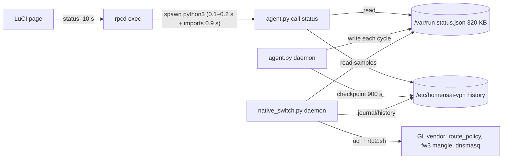
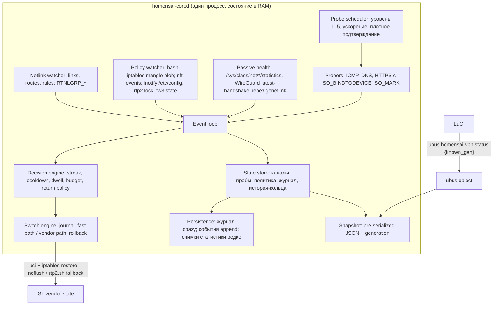

<!-- doc-role: proposal -->
# Новое резидентное ядро HomenS.AI Auto VPN — архитектурное предложение

Дата: 30.10.2026 · База: исходники 0.9.1-alpha82 (ветка `work/switching-finish-20261028`) · Устройство: GL-MT3000 (MT7981, 2×Cortex-A53 1,3 ГГц, 512 МБ RAM, 256 МБ NAND, GL 4.11.0 / OpenWrt 21.02, ядро 5.4.211).

Статус документа: **проект архитектуры, без реализации**. Здесь нет разрешения на работу с роутером, на установку или на запуск Auto. Все цифры «сейчас» — замеры на выделенном MT3000 (alpha77–82, 29–30.10.2026), если не помечено «оценка». Все цифры «цель» — оценки с указанной уверенностью; их нужно подтвердить прототипом.

Главный вывод в одной фразе: **переключение медленное не из-за Python, а из-за алгоритма** (полная пересборка политики производителем `rtp2.sh` плюс 5–7 повторных полных диагностик), а **нагрузка на CPU и флеш — из-за модели «процесс на вызов» и опроса вместо событий**. Поэтому план делит работу на две независимые линии: (1) быстрый путь переключения и быстрое обнаружение — их можно проверить ещё на Python; (2) резидентное ядро на Go, которое убирает стоимость статуса, опроса и записи.

---

## 1. Текущая архитектура

### 1.1 Процессы и потоки данных

```
                    браузер (LuCI, dashboard157.js ≈ 900 КБ, gzip ≈ 261 КБ)
                         │  poll каждые 10 с на каждую открытую страницу
                         ▼
   uhttpd ── ubus JSON-RPC ── rpcd ──exec──▶ /usr/libexec/rpcd/homensai-vpn
                                               └─ exec python3 agent.py call status   (новый процесс на КАЖДЫЙ вызов)
                                                    ├─ читает /var/run/homensai-vpn/status.json (≈320 КБ)
                                                    ├─ native_history.read_public(/etc/homensai-vpn)
                                                    ├─ switch_timing, auto_control, pair_manual, channel_path, speed_test …
                                                    └─ json.dumps → stdout → rpcd → браузер

 procd ─┬─ instance "monitor": python3 agent.py daemon          (agent.serve)
        │     цикл: inventory.lua ×2 → route_binding ×2 на профиль → probe() DNS+3×HTTPS
        │           ICMP PingSampler / WebsiteSampler (потоки) → Accounting → status.json (RAM)
        │           каждые checkpoint (900 с) → /etc/homensai-vpn/*.json (флеш)
        │
        └─ instance "native": python3 native_switch.py daemon   (native_switch.serve)
              цикл каждые ~2 с + длительность tick:
                pair_auto.tick → network()/configs() (lua) → reapply_missing_policy (attest_policy)
                → Linux.diagnostic() (≈5–6 с на MT3000) → streak() по samples из status.json
                → attempt(): ARMED → дочерний процесс "native_switch.py apply <tx>"
                      → uci reorder/commit route_policy → /usr/bin/rtp2.sh → wait_quiet → diagnostic → attest
                → WAIT-CLIENT: probe()+trace() целевого канала → COMMITTED
```



Межпроцессная связь целиком построена на JSON-файлах и `flock` (`auto_control.control_lock`, `agent.lock`, `native.lock`, `pair-auto-control.json`, `native-status.json`, `scan.request`, `speed-pause.json`…). Именно отсюда ошибки недели: нереентерабельный `flock` в `fault_start` (дедлок), гонки «стенное время против времени доказательства», кэши, теряемые между процессами, и убийство вызова rpcd через 30 с.

### 1.2 Куда уходит время и CPU

**Вызов статуса** (`agent.rpc('status')`), замеры MT3000:

| Составляющая | До alpha82 | Комментарий |
|---|---|---|
| Запуск python3 | 0,1–0,2 с | на каждый вызов |
| Импорты модулей | ≈0,9 с | `from … import` внутри `rpc()` |
| Аттестация политики ядра (`iptables-save` ×2, `ip -j rule` ×2, lua) | ≈2 с | сейчас общий 15-секундный кэш |
| Нативная диагностика | ≈1,3 с | |
| 33 чтения JSON (+16 тыс. вызовов `number()`) | ≈1 с | `read_json`, `native_history.read_public` |
| **Итого** | **5–7 с CPU** | после кэша аттестации **1,7–3,2 с** |

Ответ ≈320 КБ на каждый опрос: `native_history.events` ≈72 КБ, `accounting` ≈74 КБ, `samples` ≈31 КБ (до 1000 строк), истории отклика/пинга ≈19 КБ. Одна открытая страница — ≈8640 опросов/сутки ≈ **2,7 ГБ JSON в сутки** через rpcd/uhttpd и ≈4–8 часов CPU-времени в сутки (оценка: 8640 × 1,7–3,2 с). Две вкладки — вдвое больше. На двухъядерном A53 это главный потребитель CPU, пока открыт интерфейс.

**Цикл монитора** (`agent.serve`): на каждом проходе дважды запускается `lua inventory.lua` (до и после измерений), для каждого профиля `route_binding()` порождает 6 процессов (`ubus call network.interface.X status`, `ip -j route show table all`, `ip -j rule show`, 3× `ip route get … mark`) — и ещё раз после измерения для проверки эпохи. Для пары каналов это ≈26 fork/exec на проход только монитора, плюс TLS-рукопожатия на Python (3 на канал) и сериализация 320 КБ `status.json` в RAM на каждом проходе (и повторно в `website_publication.publish_completed`). Оценка (не замерено): 1–3 с CPU на проход.

**Цикл нативного контроллера** (`native_switch.serve` → `pair_auto.tick`): пауза всего 2 с, а сам tick вызывает `Linux.diagnostic()` (по комментарию в коде и истории alpha57 — ≈5–6 с на MT3000: `ubus call system board`, `nft --version`, SHA-256 закреплённых файлов производителя, `lua native_policy.lua`, `inventory.lua`, `route_binding` ×2, сканирование `/proc` в `_workers`) и `reapply_missing_policy` → `attest_policy` (ещё `iptables-save` ×2, `ip rule` ×2, `network()` ×2 через lua). Оценка: контроллер занят почти непрерывно, порядка 30–70 % одного ядра. **Это нужно замерить в фазе 0** (`/proc/<pid>/stat` по обоим экземплярам).

### 1.3 Обнаружение и переключение — разбор 61 секунды

Ночной тест (8 циклов, сбой основного WireGuard 180 с, уровень проверок 1 = раз в 60 с, ускорение до 10 с после первого сбоя, 3 сбоя для подтверждения):

```
t=0      сбой основного канала
t≈59 с   первая неудачная проверка (47–73 с)         ← ожидание очередного 60-с прохода + 6 с HTTP_SECONDS
t≈110 с  сбой подтверждён, начат переход (+51 с)      ← 2 доп. прохода по 10 с, но каждый проход сам длится 10–20 с,
                                                         плюс задержка tick контроллера (2 с + 5–6 с диагностики)
t≈110–171  APPLYING → COMMITTED, 46–68 с (ср. 61 с)
t≈171 с  трафик на резерве
t≈195 с  основной снова здоров; +45 с ожидание стабильности (политика владельца); возврат ≈45 с; t≈282 с на основном
```

Почему APPLYING→COMMITTED длится ~61 с (по `native_switch.attempt`, `child`, `Linux.reorder/apply`, `forward_dispatch`, `native_platform.wait_quiet`, фазы `apply_progress` и отчёт `handoff/SWITCHING-FINISH-2026-10-29.ru.md`):

1. **До запуска `rtp2` ≈35 с.** `attempt()` делает `attest_policy` (полная диагностика + `iptables-save`) и `rtp_boot.prepare`; дочерний `child()` снова вызывает `diagnostic()` и ещё раз `attest_policy`. Затем `reorder()` делает `uci reorder` по одной секции, и **перед каждой записью** `write_command → before_write()` вызывает `assert_selection` и `kernel_fingerprint()` (2× `iptables-save`, 2× `ip rule`), а после каждой записи — `self.order()` (lua). Комментарий в коде прямо фиксирует «повторные диагностики по ~5 с перед каждой записью».
2. **`/usr/bin/rtp2.sh not_reload_network` ≈10–15 с.** Скрипт производителя сбрасывает mangle-цепочки, удаляет все секции `gl_vpn_rules` в firewall, пересоздаёт их, перестраивает маршруты, DNS (`/tmp/resolv.conf.d`, `hosts.vpn`, перезапуск dnsmasq в фоне), чистит conntrack, делает `uci commit` (запись во флеш) и перезагрузку firewall в фоне.
3. **`wait_quiet()` ≥3 с, до 20 с** — ждём, пока фоновые работники GL (fw3, dnsmasq, `gl_reload_service`) утихнут.
4. **Проверка после записи ≈8–10 с**: `diagnostic()` (5–6 с) + `attest_policy` (2–3 с), потом `trace()` целевого канала и установка VPN-only guard (`backend.guard(backend.devices())`).
5. **WAIT-CLIENT ≈3–8 с**: в режиме `router-probed-ipv4` цикл делает `probe()` (DNS + 3×HTTPS, до 6 с) и `trace()`, затем перед COMMITTED — ещё `attest_policy` и ещё `trace()`.

Важное наблюдение о безопасности сети: в `child()` перед первой записью ставится `backend.guard(control_revision=…)` **без списка устройств** — это временная полная блокировка пересылки из `br-lan` (nft-набор `blocked_lan_<gen>` с тайм-аутом 90 с). То есть **все ~60 с APPLYING локальная сеть полностью без интернета**, сверх времени самого сбоя. Это правильно для пути через `rtp2` (у него есть окно, когда mangle сброшен и пакеты могут уйти мимо VPN), но именно это окно и надо убрать.

### 1.4 Запуск после обновления пакета: 2–4 минуты VENDOR-SETTLING

`vendor_observation.VendorObserver` держит «поколения» туннелей только в памяти процесса монитора. После перезапуска все поколения новые, состояние становится `SETTLED` лишь после `stable>=2` проходов; при уровне 1 это 2–3 прохода по 60 с. Ускорение `monitor_poll_interval` до 2 с работает только в первые 180 с после явного Start, а после обновления идёт возобновление, а не Start. Отсюда 2–4 минуты.

### 1.5 Где пишется флеш (`/etc/homensai-vpn`, UBIFS на NAND)

Каждая запись — `agent.atomic_json`: временный файл + `fsync(file)` + `rename` + `fsync(dir)`, то есть минимум два коммита журнала UBIFS.

| Источник (файл/функция) | Что пишется | Частота | Операций/сутки (оценка) |
|---|---|---|---|
| `agent.checkpoint` | `checkpoint.json` + `checkpoint.backup.json` + `latency-history.json` + `ping-` или `website-response-history.json` (+ `response-compare.json` при сравнении) | каждые `checkpoint` = 900 с (по умолчанию) | 96 × 4–5 = **384–480** |
| `agent.serve` (`reliability.critical`) | тот же набор внеочередно | не чаще 60 с при смене маршрута/контроллера | 10–100 (зависит от событий) |
| `probe_policy.Booster` | `probe-history.json` | каждое событие ускорения | 5–100 |
| `native_switch.publish` → `native_history.History.record` | `native-history.json` + backup (до 2 МБ, `RETENTION_BYTES`) | каждое новое состояние контроллера | ≈12–16 на одно переключение; при «дребезге» BLOCKED/ARMED — больше |
| `journal_write` | `native-transaction.json` | 6–10 на переключение | |
| `pair_auto.save`, `charge_attempt`, `switch_timing.record`, `CERT`, `native-stop.json` | состояние сессии, бюджет попыток, среднее время, сертификат | на переключение / Start / Stop | 4–6 на переключение |
| UCI производителя | `uci commit route_policy`, `rtp2.sh` → `firewall` | на каждое переключение | 2–3 файла `/etc/config` |
| `speed_test`, `telegram_state` | история скоростей, состояние Telegram | по событиям | единицы |

Итого в спокойные сутки ≈450–700 атомарных замен файлов; при 8 тестовых циклах ещё ≈300–400. Объём (оценка, требует замера `ls -l /etc/homensai-vpn` × частоты): каждая контрольная точка переписывает **целиком** все истории, поэтому логический объём порядка десятков МБ в сутки. Срыв по питанию сегодня теряет до 15 минут статистики.

---

## 2. Целевая архитектура

### 2.1 Один резидентный демон



Принципы:

- **Одно состояние в памяти** вместо 33 JSON-файлов. Межкомпонентные вызовы — функции/каналы внутри процесса, а не `flock` по файлам. Это устраняет весь класс ошибок недели (реентерабельность блокировок, кэши между процессами, гонки времени доказательства: все решения используют один монотонный источник времени и одно поколение наблюдения).
- **Тонкий интерфейс.** Демон сам регистрирует ubus-объект `homensai-vpn` (протокол ubus — простые TLV blobmsg через unix-сокет `/var/run/ubus.sock`). ACL rpcd (`/usr/share/rpcd/acl.d/luci-app-homensai-vpn.json`) действует на имя объекта и метода, поэтому контроль доступа не меняется. Exec-плагин rpcd удаляется (или остаётся тонким клиентом для совместимости).
- **Статус из памяти за миллисекунды.** Снимок сериализуется один раз при изменении состояния и хранится с номером поколения. `status {known_gen:N}` возвращает `{"unchanged":true,"gen":N}` (≈50 байт), если ничего не изменилось. Живая часть (каналы, лампы, политика проб, состояние Auto, последние 20 замеров) — 5–15 КБ. Истории (`samples`, `events`, `native_history`, `accounting`, графики) — отдельными методами по запросу с курсором `since` (дельта), а не в каждом опросе.
- **Планировщик проб** исполняет настройки владельца без изменения их смысла: уровень 1–5 задаёт базовый интервал полной проверки (60/30/20/15/10 с) и интервал замера отклика; «Автоматическое ускорение» остаётся; «3 неудачные проверки» остаётся. Меняется только плотность подтверждения (раздел 3.3).
- **Наблюдатель политики ядра вместо опроса.** rtnetlink-подписка на правила/маршруты/интерфейсы (события, без опроса). У iptables-legacy (fw3) **нет событий**, поэтому mangle наблюдается дешёвым опросом бинарного blob'а таблицы через `getsockopt(IPT_SO_GET_INFO / IPT_SO_GET_ENTRIES)` раз в 1–2 с и сравнением хэша (≈1 мс, без fork). Полный разбор и `kernel_policy.attest` выполняются только при изменении хэша или перед записью. Плюс inotify на `/etc/config/{route_policy,network,firewall,homensai_vpn}`, `/tmp/run/rtp2.lock`, `/var/run/fw3.state` для мгновенного «производитель что-то делает». Попутно: `iptables -V` на устройстве должен показать `legacy` — это проверить в фазе 0.
- **Кэш диагностики с инвалидацией по событиям.** Модель платы, версия прошивки, SHA-256 закреплённых файлов (`native_platform.PINS`, `rtp_boot.PINS`, `native-audit-hashes.json`) пересчитываются только при изменении inode/mtime/size, а не каждые 2 с. Проверка «производитель занят» (`mt3000_manual_platform._workers`) — по inotify-сигналам и короткому сканированию `/proc` только перед записью.

### 2.2 Хранение: RAM прежде всего

- **Журнал транзакции** (`native-transaction.json`) остаётся на флеше и пишется с fsync сразу: это основа восстановления после сбоя, и без него нельзя гарантировать откат. Число записей на переключение сокращается с 6–10 до 3 (ARMED, APPLIED, COMMITTED/ROLLED-BACK).
- **События** (переходы, сбои, ускорения) — в append-only сегмент (ndjson) с одним fsync на событие или пачкой не чаще раза в 10 с; ротация суточными сегментами, удаление по сроку хранения. Нет переписывания 2 МБ истории ради одной строки.
- **Статистика** (accounting, графики) — в RAM; снимок на флеш раз в час (настройка владельца 300–3600 с сохраняется; меняется значение по умолчанию на 3600) и при штатной остановке/обновлении. Одна резервная копия ротируется не каждый раз, а раз в сутки.
- Переживание обновления пакета: перед остановкой демон кладёт полный снимок состояния в `/var/run` (RAM), новая версия его подхватывает (включая поколения туннелей производителя) — это убирает 2–4 минуты VENDOR-SETTLING.

---

## 3. Ключевая часть: быстрое переключение

### 3.1 Что на самом деле нужно изменить в ядре

По `kernel_policy.attest` проверяемая политика выглядит так (FW3 mangle, iptables-legacy):

```
PREROUTING → VPN_PREROUTING_HOOK → (-i br-lan) ROUTE_POLICY
ROUTE_POLICY:
  1. CONNMARK --restore-mark (если у соединения уже есть метка 0xf000)
  2. UDP/53 на локальный адрес → RETURN
  3. ! --dst-type LOCAL → TUNNEL<A>_ROUTE_POLICY     ← первый в списке выигрывает
  4. ! --dst-type LOCAL → TUNNEL<B>_ROUTE_POLICY
TUNNEL<X>_ROUTE_POLICY:
  mark 0/0xf000 → MARK --set-xmark <mark_X>/0xf000
  mark 0/0xf000 → DROP                              ← Kill Switch
ip rule: priority 6000 fwmark <mark_X>/0xf000 lookup <table_X>
  (wgclientN: mark (N)<<12, table 1000+N; ovpnclientN: mark (9+N)<<12, table 1010+N — kernel_policy.static_bindings)
```

Оба туннеля в парном режиме **уже подняты**, у каждого есть своя таблица маршрутизации и своё `ip rule`. Переключение «основной ↔ резерв» с точки зрения пакетов новых соединений — это **перестановка двух jump в цепочке `ROUTE_POLICY`**. Всё остальное, что делает `rtp2.sh` (сброс и пересборка всех mangle-цепочек, удаление/создание секций firewall, DNS, conntrack, перезагрузка fw3), — побочная работа полной пересборки.

### 3.2 Быстрый путь: атомарная смена политики без пересборки производителя

Предлагаемая последовательность (≈2–5 с вместо ≈61 с):

1. **Резерв заранее проверен (hot standby).** Пока Auto работает, ядро постоянно держит для резерва: свежую квору DNS+HTTPS (не старше одного интервала), неизменную привязку (device/mark/table/ifindex — по netlink-событиям), наличие `ip rule` и цепочки `TUNNEL<B>`. Требование «2 успешные проверки резерва» обычно уже выполнено к моменту подтверждения сбоя основного.
2. **Предпроверка из кэша (<50 мс).** Ревизия управления (Stop/Start fence), хэш mangle-blob совпадает с аттестованным, хэш UCI `route_policy` совпадает, производитель не занят (нет `rtp2.lock`, `tunnel-switch*.lock`, очередей `gl_reload_service`), блокировки — те же, что в `diagnostic()`. Полная диагностика уже выполнена при последнем изменении состояния; повторять её 5–7 раз не нужно.
3. **Журнал ARMED** (одна запись с fsync) — с исходным порядком, исходным хэшем ядра и целевым порядком.
4. **Сторож отката (dead-man switch).** Отдельный минимальный процесс (или nft-таймер) восстанавливает исходный порядок `ROUTE_POLICY`, если ядро не подтвердило переход за N секунд (например, 20 с). Идея та же, что у существующего `schedule_release` для guard: откат должен случиться, даже если ядро-демон умер.
5. **Атомарная запись ядра.** `iptables-restore --noflush -T mangle` с объявлением только `:ROUTE_POLICY - [0:0]` и теми же четырьмя правилами в новом порядке. iptables-legacy заменяет таблицу одним `setsockopt(IPT_SO_SET_REPLACE)`: в ядре нет промежуточного состояния, когда пакет не получил метку. Kill Switch (`DROP` при нулевой метке) не трогается. **Полная блокировка LAN не нужна** — остаётся постоянный VPN-only guard (`Linux.guard(devices)`), который и сейчас держится при работающем Auto.
6. **Сохранение намерения для производителя.** `uci reorder route_policy.<секция>=<индекс>` + `uci commit route_policy` одним вызовом (≈50–100 мс, одна запись флеша) — чтобы любая следующая пересборка производителем (hotplug туннеля, перезагрузка firewall, перезагрузка роутера) построила **ту же самую** политику. `rtp2.sh` при этом не запускается.
7. **Сессии старого канала.** При переходе с отказавшего канала — удалить через netlink conntrack-записи LAN-соединений с меткой отказавшего туннеля (`ctmark & 0xf000 == mark_A`), иначе `CONNMARK --restore-mark` будет держать уже идущие UDP-потоки (QUIC, VoIP, игры) на мёртвом туннеле до 180 с тайм-аута UDP-stream. При ручном переключении или возврате на здоровый основной — **не удалять**: старые сессии спокойно доживают на старом канале (make-before-break), новые идут через новый.
8. **Проверка.** Перечитать mangle и `ip rule`, выполнить `kernel_policy.attest` для нового порядка (роль = целевая), одну квору DNS+HTTPS + `trace` через целевой канал (обычно ≤1,5 с — резерв проверен секунды назад). Только после этого журнал COMMITTED, снятие сторожа, событие в историю.
9. **Отказ на любом шаге** — обратный атомарный `iptables-restore` исходного порядка + `uci` исходного порядка, затем аттестация исходного состояния; при неуспехе — существующий путь `rollback_recovery.rebuild` через `rtp2.sh` с полной блокировкой LAN на время пересборки (как сегодня).

Возврат на основной (RESTORING → ROLLED-BACK, сейчас ≈45 с) идёт тем же путём, ≈2–5 с. Ожидание стабильности основного (`primary_successes`, `primary_stable`) — политика владельца, она не сокращается без его решения.

### 3.3 Быстрое обнаружение

Сейчас здоровье канала — это только полная квора (DNS + ≥2 из 3 HTTPS), а ICMP-пинг «никогда не влияет на решения Auto» (`agent.serve`). Предлагается многосигнальная схема, в которой **доказательство отказа остаётся прежним** (3 неудачные полные проверки), а меняются **подозрение** и **плотность подтверждения**:

| Сигнал | Стоимость | Роль |
|---|---|---|
| Счётчики `/sys/class/net/<dev>/statistics`: tx растёт, rx стоит N секунд при трафике LAN | ноль (чтение sysfs) | подозрение |
| WireGuard `latest-handshake` и rx-байты пира через genetlink (`wgctrl`) | ноль | подозрение; рукопожатие старше 180 с при попытках tx — сильный сигнал |
| OpenVPN: состояние интерфейса/процесса; management-сокет, **если** GL его включает (проверить) | ноль | подозрение |
| ICMP-пинг 1.1.1.1 и второй адрес через канал (уже есть `icmp_ping.PingSampler`) | ≈0 CPU | подозрение: 2 потери подряд из 2 адресов |
| TCP RST / тайм-аут connect в HTTPS-пробе | часть пробы | детализация причины |
| Полная квора DNS + 3×HTTPS (существующая `probe()`) | 3 TLS-рукопожатия | **доказательство** |

Интервал ICMP-сторожа привязан к уровню владельца (уровень 1 → раз в 5 с, уровень 5 → раз в 1 с), пассивные сигналы бесплатны и работают всегда. При подозрении планировщик запускает **плотное подтверждение**: 3 полные проверки с шагом 3 с и тайм-аутом 3–4 с (вместо 10-секундных проходов, которые на практике растягиваются до 15–20 с). Если хоть одна проверка успешна — эпизод закрыт и записан в журнал решений как сейчас. Если сбой касается только TCP (ICMP проходит), обнаружение откатывается к базовому интервалу уровня — это честное ограничение.

Ожидаемый тайминг при сбое типа «туннель перестал пропускать»: подозрение 2–6 с (уровень 5) / 5–12 с (уровень 1), подтверждение +6–12 с ⇒ **10–25 с от начала сбоя до решения** вместо ≈110 с.

### 3.4 Что зависит от GL и обязано быть проверено на устройстве

Быстрый путь допустим, только если доказано, что он даёт **то же состояние ядра**, что и `rtp2.sh`. Пока это не доказано, он выключен и работает текущий путь.

1. **Дельта `rtp2.sh` между двумя порядками.** На выделенном MT3000 в согласованном окне снять полный снимок до/после `rtp2` для порядка «A первым» и «B первым»: `iptables-save` (все таблицы), `ip rule`, `ip route show table all`, ipset, `uci show firewall/route_policy/network/dhcp`, `/tmp/resolv.conf.d/*`, `/tmp/hosts.vpn`, конфигурация dnsmasq, conntrack до/после. Быстрый путь разрешён только если дельта = порядок `ROUTE_POLICY` (+ формально описанные дополнения). Из статического аудита (`docs/FAILOVER-RESEARCH.md`) известно, что `rtp2.sh` «перестраивает маршруты, DNS и firewall» и вызывает `clean_conntrack` — **DNS почти наверняка входит в дельту**: если upstream dnsmasq привязан к первому туннелю, быстрый путь должен атомарно сменить файл серверов и отправить dnsmasq SIGHUP (≈0,1 с), иначе DNS клиентов LAN продолжит ходить через отказавший канал.
2. **Реакция производителя на `uci commit route_policy` без `rtp2`.** Проверить (inotify + журнал процессов), не запускают ли демоны GL пересборку сами — тогда появится окно сброса mangle, и быстрый путь недопустим без guard.
3. **Повторная пересборка производителем в любой момент** (hotplug ifup туннеля, смена WAN, перезагрузка firewall) обязана давать ту же политику — это обеспечивает шаг 6 (UCI совпадает с ядром). Проверить принудительной перезагрузкой firewall после быстрого переключения: хэш mangle после ≡ хэш после быстрого пути.
4. **iptables-legacy против iptables-nft** и поведение `iptables-restore --noflush` для одной цепочки в mangle (атомарность через `IPT_SO_SET_REPLACE`).
5. **Удаление conntrack по метке через netlink на ядре 5.4** (dump с фильтром метки + удаление по записи) и что именно делает `clean_conntrack` производителя.
6. **Аппаратное ускорение (hnat)** уже является блокером в `diagnostic()`; без него быстрое переключение потоков не гарантировано — условие сохраняется.
7. **Интерфейс GL**: показывает ли он порядок VPN из UCI (тогда всё согласовано) и не перезаписывает ли его.

Привязка к прошивке: быстрый путь получает собственный «сертификат дельты» — SHA-256 `rtp2.sh` и связанных файлов (как `rtp_boot.PINS`) + версия прошивки 4.11.0 + плата. Любое расхождение — только путь через производителя.

### 3.5 Запасной вариант: оптимизированный путь через производителя

Если дельта окажется сложнее (например, DNS нельзя безопасно сменить отдельно), то и без отказа от `rtp2.sh` можно сократить 61 с до ≈15–25 с:

- одна предпроверка из кэша вместо `attest_policy` ×2 + `diagnostic()` ×2 до записи и `kernel_fingerprint()` перед каждой UCI-командой (−25…−30 с);
- все `uci reorder` одним вызовом `uci batch` и одним commit;
- `rtp2.sh` (10–15 с, производитель) + `wait_quiet` по событиям inotify, а не опросом;
- после — одна аттестация (из события изменения mangle-blob) и одна квора целевого канала (−8…−10 с).

Полная блокировка LAN на время `rtp2` здесь сохраняется.

### 3.6 Безопасность: «никогда не ломать сеть владельца»

Сохраняются без исключений: аттестация политики ядра до и после записи; журнал на флеше и откат при любом сомнении; восстановление после перезапуска процесса/питания по журналу; fence ревизии управления (Stop всегда побеждает); никаких изменений LAN/Windows/IPv6 сверх существующего guard; выбор модели не обходит проверки платы/прошивки/готовности; условия использования принимает только владелец; Auto никогда не запускается сам. Новое: сторож отката, не зависящий от процесса-ядра; быстрый путь включается только при действующем сертификате дельты и только на квалифицированной связке MT3000 / 4.11.0; при любом неизвестном состоянии (хэш mangle не тот, производитель занят, UCI с незакоммиченными изменениями) — отказ до записи, как сейчас.

---

## 4. Оценки «сейчас → цель»

| Показатель | Сейчас (замер) | Цель | Снижение | Уверенность |
|---|---|---|---|---|
| Сбой → первая неудачная проверка | 47–73 с (ср. 59) | 2–12 с (ICMP/пассивные сигналы) | 80–95 % | средняя |
| Сбой → подтверждение | ср. 110 с | 10–25 с | 77–91 % | средняя |
| APPLYING → COMMITTED | 46–68 с (ср. 61) | быстрый путь 2–5 с; запасной 15–25 с | 92–97 % / 60–75 % | быстрый — низкая до проверки дельты; запасной — средняя |
| Сбой → трафик на резерве | ср. 171 с | 15–30 с (быстрый) / 30–50 с (запасной) | 82–91 % / 70–82 % | средняя |
| Полная блокировка LAN во время перехода | ≈46–68 с | 0 с (быстрый) | до 100 % | средняя |
| Лампы «серые» (нет подтверждения канала) | 10–50 с | <5 с | ≈90 % | средняя |
| Возврат на основной (сам переход) | ≈45 с | 2–5 с | ≈90 % | низкая–средняя |
| Основной снова здоров → трафик на основном | ≈87 с | ≈40–50 с (стабильность 30–45 с — политика владельца) | ≈45 % | средняя |
| CPU на опрос статуса | 1,7–3,2 с | 2–20 мс | >99 % | высокая |
| Ответ статуса | ≈320 КБ | 5–15 КБ; «без изменений» ≈0,1 КБ | 95–99,9 % | высокая |
| Фоновый CPU (монитор + контроллер) | оценка 30–80 % одного ядра (замерить) | 1–3 % | ≈95 % | средняя |
| Процессов fork/exec в минуту | оценка 300–600 | <5 (только UCI/iptables-restore при записи) | >98 % | высокая |
| RAM | оценка 50–110 МБ пик (2 демона Python по 20–30 МБ + 20–30 МБ на каждый вызов rpcd + дочерний apply) | 10–20 МБ (Go, `GOMEMLIMIT`) | 70–85 % | средняя |
| Записей файлов во флеш в сутки | ≈450–700 (+UCI на переход) | ≈30–60 | 85–95 % | средняя |
| Логический объём записи во флеш | десятки МБ/сутки (оценка) | <2–5 МБ/сутки | 85–95 % | низкая–средняя (замерить) |
| Старт после обновления до OBSERVING | 2–4 мин | 20–60 с | 60–90 % | низкая–средняя |
| Первичная загрузка интерфейса | 900 КБ JS (261 КБ gzip) | 350–450 КБ (ленивые модули: обучение, аналитика, справка) | ≈50 % | средняя |

Обоснование ключевых чисел: статус из готового буфера — это одна ubus-передача без интерпретатора; 3 TLS-рукопожатия на канал в Go/C на A53 — порядка 5–15 мс CPU каждое, поэтому даже уровень 5 (раз в 10 с, 2 канала) — <1 % CPU; основное время быстрого перехода — одна квора проверки целевого канала (≈0,3–1,5 с) и `uci commit` (≈0,1 с).

---

## 5. Выбор языка, фазы миграции, риски

### 5.1 Сравнение

| Критерий | Python резидентный | **Go** | C (libubox/uloop) | Rust |
|---|---|---|---|---|
| Бинарник / флеш | 0 (python3 уже есть) | 6–9 МБ static (`-s -w`, без UPX) | 0,1–0,3 МБ + либы прошивки | 2–5 МБ (rustls/ring) |
| RSS | 25–40 МБ | 10–20 МБ | 1–3 МБ | 2–6 МБ |
| Сборка aarch64 musl | не нужна | `CGO_ENABLED=0 GOARCH=arm64` — без SDK | нужен GL SDK mt7981/21.02 | `aarch64-unknown-linux-musl`, кросс-компилятор для ring |
| ubus | нет готового | свой blobmsg-клиент (≈600–900 строк) | родной libubus | незрелые крейты |
| netlink / nft / WireGuard / conntrack | subprocess | зрелые: vishvananda/netlink, google/nftables, wgctrl, ti-mo/conntrack | libmnl/libnftnl | rtnetlink, neli; nft слабее |
| TLS + проверка сертификатов | ssl (OpenSSL) | crypto/tls в stdlib | ustream-ssl/mbedtls | rustls |
| Сопровождение командой | высокое | высокое, простой язык | низкое, риск памяти | среднее, высокий порог |
| Риск переписывания | минимальный | средний | высокий | средне-высокий |

**Выбор: Go** для ядра. Причины: статическая сборка без зависимости от SDK производителя (а вопрос «matching-SDK provenance» в проекте открыт), лучшая экосистема netlink/nftables/WireGuard/conntrack, TLS в стандартной библиотеке, горутины естественно ложатся на независимые пробы, понятный код для дальнейшей поддержки. 6–9 МБ на 256-МБ NAND и 10–20 МБ RAM из 512 МБ — приемлемо и всё равно меньше нынешних нескольких процессов Python. C даёт минимальный размер, но рискованнее и дороже в сопровождении; Rust безопаснее C, но медленнее в разработке и слабее в nft/ubus. Python-резидент — **промежуточная ступень**, а не цель: он убирает стоимость старта процесса, но оставляет 25–40 МБ RAM, subprocess для iptables и дорогую сериализацию.

Особо: **ускорение переключения от языка не зависит** — его дают быстрый путь (3.2) и плотное подтверждение (3.3). Поэтому их разумно проверить ещё в Python-исполнителе с уже испытанным журналом, а Go-ядро строить параллельно в теневом режиме.

### 5.2 Фазы (каждая — отдельный выпускаемый пакет)

**Фаза 0. Замеры, без изменения поведения.** Счётчики CPU по процессам (`/proc/<pid>/stat` раз в минуту в RAM), число fork/exec, счётчик и объём `atomic_json` по файлам, разбивка `apply_progress` по секундам, `iptables -V`, свободное место overlay. Приёмка: отчёт с реальными числами вместо оценок этого документа.

**Фаза 1. Быстрые выигрыши на Python.** Монитор материализует готовый снимок страницы с номером поколения; метод `status` отдаёт живую часть + `gen`; истории — отдельные методы с курсором; exec-плагин отвечает на `status` без запуска Python (статический клиент или `cat` готового файла). Кэш проверок производителя по mtime/inode. Контрольная точка по умолчанию 3600 с, события — append. Сохранение поколений производителя в `/var/run` через перезапуск. Приёмка: CPU статуса <50 мс, ответ <20 КБ, паритет интерфейса (все тесты страницы), ночной тест 8 циклов с прежними результатами переключения; статистика после выключения питания теряет ≤1 ч (зафиксировать как решение владельца).

**Фаза 2. Эксперименты на выделенном MT3000** (только с разрешением владельца и по `private/ACTIVE-EXECUTOR.local.json`): захват дельты `rtp2` (3.4 п.1–5), проверка атомарности `iptables-restore --noflush`, реакция GL на `uci commit route_policy`, conntrack по метке, DNS. Приёмка: подписанный протокол дельты; сертификат дельты для 4.11.0.

**Фаза 3. Быстрый путь в Python-исполнителе** за флагом и сертификатом дельты, со сторожем отката; плотное подтверждение и ICMP/пассивные сигналы подозрения. Приёмка: ночной тест 8 циклов — подтверждение p95 ≤25 с, APPLYING→COMMITTED p95 ≤5 с, трафик на резерве p95 ≤30 с, после каждого перехода принудительная перезагрузка firewall не меняет хэш mangle; 24-часовой прогон без сбоев на уровне 1 — **ноль ложных переключений**; убийство процесса на каждом шаге — откат по журналу.

**Фаза 4. Go-ядро в теневом режиме.** `homensai-cored` наблюдает, пробует, принимает решения «на бумаге» и отдаёт объект `homensai-vpn.core` только для чтения; Python продолжает управлять. Приёмка: 24 ч, расхождение решений Go и Python = 0 (дифференциальный журнал), RSS <20 МБ, CPU <3 %. Тестовый корпус Python (JSON-фикстуры аттестации, streak, журнала) переиспользуется как общий «золотой» набор для обоих языков.

**Фаза 5. Go берёт мониторинг, статус и обнаружение.** Python-монитор выключается; контракт `status.json` в RAM сохраняется для Python-исполнителя; ubus-объект `homensai-vpn` регистрирует ядро; страница переходит на дельта-опрос и ленивые модули. Приёмка: ночной тест 8 циклов не хуже фазы 3; паритет всех методов RPC; отказ ядра → procd перезапуск без влияния на маршрутизацию.

**Фаза 6. Go-исполнитель переключения** с той же схемой журнала (Python-восстановление читает его и наоборот на время перехода). Самая рискованная фаза — последняя. Приёмка: все QEMU-сценарии повтора, kill -9 на каждом этапе, отказ записи флеша, ночной тест 8 циклов в обе стороны; отключение питания — отдельная приёмка (остаётся отдельной областью по ROADMAP).

Внешняя приёмка LAN-клиентом, суточный прогон, отключение питания, IPv6 и непрерывный режим MT6000 остаются **отдельными** областями, как в `docs/ROADMAP.md`; новое ядро их не закрывает автоматически.

### 5.3 Риски

| Риск | Мера |
|---|---|
| Дельта `rtp2` включает DNS/ipset/секции firewall, которые нельзя безопасно повторить | быстрый путь только по сертификату дельты; иначе запасной путь (3.5) |
| Демоны GL сами запускают пересборку после `uci commit` | проверка в фазе 2; при подтверждении — guard на время окна или отказ от быстрого пути |
| Ложные переключения из-за ICMP | ICMP только подозрение; доказательство — прежние 3 полные проверки; 24-часовой прогон с нулём ложных |
| Расхождение двух реализаций во время миграции | теневой режим, дифференциальный журнал, общий корпус фикстур |
| Собственная реализация ubus | узкий набор методов, фаззинг blobmsg, ACL rpcd без изменений; запасной вариант — тонкий exec-клиент к unix-сокету |
| Размер Go-бинарника и overlay | проверить свободное место в фазе 0; один бинарник для монитора, статуса и исполнителя |
| Обновление прошивки GL меняет закреплённые файлы | как сейчас: блокер `VENDOR-CODE-CHANGED`, быстрый путь выключается |
| Потеря статистики при сбое питания (реже снимки) | события пишутся сразу; интервал снимка — настройка владельца |

### 5.4 Что прототипировать первым на выделенном MT3000

1. Фаза 0 — только чтение: CPU по процессам, fork/exec, записи флеша, `iptables -V`, свободное место, разбивка 61 с по `apply_progress`.
2. Захват дельты `rtp2.sh` для двух порядков (требует согласованного окна: `rtp2` меняет сеть).
3. Атомарная перестановка `ROUTE_POLICY` через `iptables-restore --noflush` со сторожем отката, затем принудительная перезагрузка firewall и сравнение хэшей.
4. Удаление conntrack по метке и поведение уже идущего UDP-потока.
5. Стоимость полной кворы и ICMP-сторожа в Go на A53 (отдельный тестовый бинарник, только чтение, без изменений сети).

Каждый шаг — с сохранением неудачных доказательств, контрольной точкой исходников и без возобновления исторических наблюдателей и правил сбоев.
